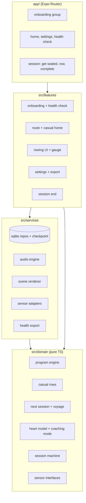
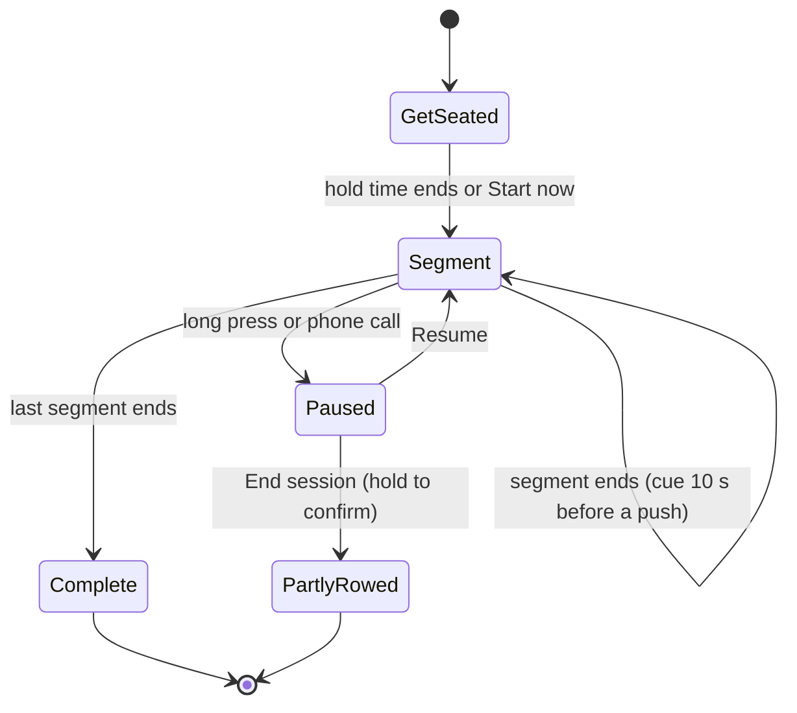
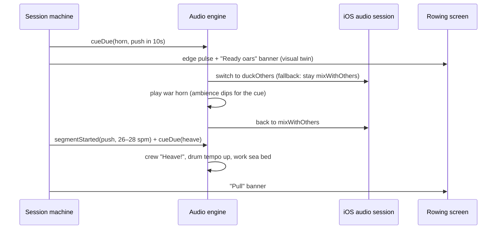

# feat: Rebuild Nor4x4 as an Expo rowing voyage

**Target repo:** `nor4x4-app` — the new Expo project, which also holds this plan, its origin requirements, `STRATEGY.md`, and the design boards. Every file path is relative to `nor4x4-app`. The legacy SwiftUI app at `../Nor4x4/` is behavioural reference only.

## Summary

Build a new iOS-first Expo app that delivers the brainstormed Nor4x4: a role-play rowing app where every row is a scene in an ink-painted viking voyage.
- **Two paths:** on the first screen, rowers pick the Beginner 4x4 program or "Just row" at an effort and length they choose. Either way the ship sails Bergen → Iceland.
- **Hands-free:** it works at 1 m with or without a heart-rate strap.
- **Signals, not speech:** there is no spoken voice. Horn calls, drum signals and crew chants carry every cue, each with an on-screen twin.
- **On the phone only:** data stays on the iPhone.
- **v1 audience:** the builder and about five TestFlight testers.

The build tests the riskiest bet first. A **rowable slice** (one hardcoded session with the scene, drum, horn and crew) is rowed on a real erg by the builder and two other rowers before onboarding, the database or the scheduler exist. Three milestones mark what is usable along the way (see Milestones).

**Changes on 2026-10-31.** This revision applies the following:
- the doc review (35 findings, 4 at P1);
- the product and UX reviews and `STRATEGY.md`;
- the scope decisions: PM5 after v1, missed sessions wait;
- the five-reviewer skeptic review: all verdicts ISSUES, 20 P1s, all resolved in the requirements (R1–R64, AE1–AE19).

What the skeptic review changed in this plan:

- **Sound:** no spoken caller. The signal table (R40) has signals that never mute (R41) and a Silent mode that lets the app suspend (R43).
- **Safety:**
  - Effort-led coaching with an estimated max or heart-rate medication (R30, R50).
  - Max HR corrects in both directions (R37).
  - A PAR-Q+ health check before the first row, which can block every row (R5).
  - A stop-warning line (R61).
  - Long-break tiers (R60).
  - One easy band of 60–70% (R57).
- **Definitions:**
  - What a day, a stop and a week mean (R62).
  - "Row it now" on any day (R49).
  - What switching paths does (R59).
  - Short on time is 19 min and counts as done (R12).
- **Scope:**
  - Beginner only in v1 (R11 deferred).
  - A benchmark-row retest with the distance typed in (R45).
  - A CSV export (R63) and on-device storage (R64).
  - Gates with outside testers, a costs line in `STRATEGY.md`, and an App Store milestone (M4) as follow-up.
- **Build:**
  - A ducking spike with the screen locked, with a written fallback.
  - Sensor interfaces and fakes moved into M1 (U6).
  - U4 split into U4a and U4b.
  - Timing fixes and session checkpoints.
  - The missing release work: icon, usage strings, privacy and crash logs.
  - An effort estimate.

---

## Problem Frame

Rowing on a home machine is monotonous, especially on rowers with no monitor, so people stop; guided workouts sit behind subscriptions or connected hardware (see `STRATEGY.md`). The SwiftUI app is a stock-looking interval timer over nine hardcoded plans with an over-aggressive progression, no recovery or easy work, no max-HR model, and unused history (see origin). The rebuild replaces it rather than migrating it.

---

## Requirements

All 64 origin requirements carry forward (R11 is now a deferral). Grouped for traceability:

- **R1–R7. Onboarding.**
  - The voyage-first choice between two paths, the method explainer, and name and level (Beginner only in v1).
  - Max heart rate with a medication option. On the casual path max heart rate is optional ("Row by feel").
  - The PAR-Q+ health check before the first row.
  - The strap prompt at the first Set out.
  - The weekly plan.
- **R8–R17. Training program.**
  - Polarized weeks, and hard-day spacing with its fallback.
  - The Beginner table, with benchmark rows in weeks 1 and 8.
  - Intermediate and Expert deferred.
  - Short on time (19 min).
  - Rotating easy-row formats, the long row, the remembered length, and the format swap.
  - Coach review (R17).
- **R18–R22, R48, R49, R60, R62. Home and voyage.**
  - The route list with a map strip, today's card, and Row freely.
  - Missed sessions that wait, the voyage end, and the weekly tally.
  - The rest day with "Row it now", and the long-break tiers.
  - Definitions.
- **R23–R25, R61. Session start.** Get seated with a drum count-in, the stroke demo, reduced motion, and the stop-warning line.
- **R26–R34, R50–R52. Rowing mode.**
  - The scene and per-leg scenery.
  - The gauge, with a 22 pt zone chip and session time left.
  - Effort-led zone states, effort guidance with the "Hold!" cue, and "Strap lost".
  - A strip with taller push segments.
  - Visual twins, timers, pausing, both orientations, and keep-awake.
- **R35–R37. Heart-rate coaching.**
  - Lag-aware scoring, with pushes under 3 min unscored.
  - Ease-off at 95% held for 15 s: three bells, a border glow and the chip.
  - Max HR self-corrects in both directions.
- **R38–R43. Sound.**
  - Ambience and signals.
  - The signal table (no spoken voice).
  - Signals never mute.
  - Sound modes and the mixer.
  - Background audio, except in Silent.
- **R44–R46, R53, R54. After the session.**
  - The landfall moment and stats.
  - The benchmark retest, Apple Health, the 1–5 rating, and Partly rowed.
- **R47, R63, R64. Settings and data.** Settings, the CSV export, and on-device storage.
- **R55–R59. Just row (casual path).**
  - No schedule, one stop per row, and effort and length per row.
  - Zones of 60–70%, 70–80% and 80–85%.
  - Scenes that differ at 1 m.
  - Path switching.

Origin actors A1 and A2, flows F1–F5, and acceptance examples AE1–AE19 are honoured by the units below. A3 (the PM5) is deferred until after v1.

---

## Milestones

| Milestone | What it proves | Units | Exit check | Estimate (one builder, full time) |
|---|---|---|---|---|
| **M1 · Rowable slice** | Rowing in the voyage is fun and readable | U1–U7 | The builder rows the slice 3–5 times and two other rowers row it once each. Each row is rated for enjoyment and readability at 1 m, and the go/change verdict is written in `docs/spikes/rowable-slice.md` | 5–7 weeks |
| **M2 · My own coach** | The program and both paths work day to day, with no sensors | U8–U20 | Two weeks of daily use with no blocking bugs. At weeks 4–6 the builder is still rowing about three times a week (the bet's second gate) | 9–12 weeks |
| **M3 · Full v1** | Strap, Apple Health, polish, TestFlight | U21–U23 | TestFlight installed by the builder and about five testers, whose CSV exports come back; release checklist complete | 5–7 weeks plus art |
| **M4 · App Store** (follow-up) | Public release | Not planned here | Legal review of the health check, store listing, privacy label | — |

M1 is a hard gate: if the slice isn't fun, the scene and sound change before M2 starts. The estimates come from the plan review and assume an experienced builder; final art could double M3.

---

## Key Technical Decisions

- KTD1. **Expo SDK 58 with a development build from day one.** BLE, HealthKit, layered audio, and the custom audio module all need native code, so Expo Go is never the target.
- KTD2. **Expo Router for navigation.** Onboarding and the main app are separate route groups gated on a completed profile. The profile records the rower's path (`fourByFour` or `casual`).
- KTD3. **Pure TypeScript domain core.**
  - Program generation, casual-row plans, next-session logic, heart-rate math and the session state machine live in a dependency-free domain layer with exhaustive unit tests.
  - Dependencies point one way: routes → features → services → domain.
- KTD4. **expo-sqlite with Drizzle for all persistence.**
  - Repository tests run under Node against `better-sqlite3` through Drizzle's driver swap.
  - One on-device migration smoke test covers what that swap can't.
  - An in-progress session is checkpointed every 10 s, so a killed app resumes or saves the row instead of losing it.
- KTD5. **Session time derives from a monotonic clock, not ticks or `Date.now()`.**
  - Elapsed time is `now − start − paused`, re-synced on app resume.
  - Cues are scheduled ahead on the audio clock. The audio clock is re-mapped to session time after every interruption or route change, and scheduled cues are cancelled on pause.
  - A cue more than 2 s late on resume is dropped, not played late.
- KTD6. **@shopify/react-native-skia + Reanimated 4 for the painted scene.**
  - SkSL runtime effects give the ink-bleed, paper grain and displacement look.
  - Uniforms (time, beat phase, sea state) run on the UI thread.
  - The drum's beat phase is the single clock for the oars.
- KTD7. **react-native-audio-api for sound.** A single Web-Audio context gives sample-accurate loops, tempo control and one-shots on a shared clock.
- KTD8. **Local Expo module for detecting the user's music.**
  - A small Swift module returns `secondaryAudioShouldBeSilencedHint` and emits its change notification. react-native-audio-api has no equivalent.
  - The app re-checks it on every return to the foreground.
- KTD9. **Signals duck the music by switching the session mode.**
  - The session runs `mixWithOthers`. Each signal (horn, drum count, crew call, bells) switches to `duckOthers`, plays, and switches back.
  - Releasing the duck may need `setActive(false, notifyOthersOnDeactivation)`, which can stop our own audio or lose the background grant while the screen is locked. The U4a spike tests 20 cues in a row with the screen locked and measures how long the music takes to return to full volume.
  - **Fallback, decided now:** no ducking. Signals are mixed loud over the music.
- KTD10. **Sensors behind interfaces with fake devices, from M1.**
  - `HeartRateSource` and `RowerSource` are domain interfaces with simulated implementations created in U6. BLE implementations come in U21.
  - Live heart rate comes from Bluetooth straps only; no Apple Watch in v1.
- KTD11. **BLE library: the maintained ble-plx fork first.**
  - U4b tries `@sfourdrinier/react-native-ble-plx` (claims SDK 57+ support) against an H10 and falls back to react-native-ble-manager.
  - Background heart rate uses the `bluetooth-central` background mode.
- KTD12. **No stroke measurement in v1.**
  - PM5 support is deferred, so the gauge, drum and stats use the session's target stroke rate.
  - `RowerSource` keeps only its fake implementation.
  - When PM5 support is built: parse Concept2's rowing service (general status `0x0031`, additional status `0x0032`) as pure functions, using `ergometer-js` and `c2bluetooth` as byte-layout references.
- KTD13. **@kingstinct/react-native-healthkit for Apple Health.**
  - Workouts are saved as `rowing`.
  - Indoor metadata and attached HR samples are not documented in its README, so U4b verifies both.
  - If either is missing, save the workout without them.
- KTD14. **Responsive layout over orientation locks.**
  - Rowing screens lay out from window dimensions, and both orientations are first-class (R33).
  - Which one gets polished first follows the builder's own holder (see Open Questions).
- KTD15. **Shuimo tokens ported as a TypeScript theme.** Values come from `../../ShuimoDS/Sumi-Design-System/colors_and_type.css`, plus the adapted push and steady roles, sail red, and destructive red agreed in the origin.
- KTD16. **Program content is data, not code.** The voyage table, casual effort zones and the benchmark protocol live in versioned data files, so a coach's review changes numbers without touching logic.
- KTD17. **One voyage model for both paths.**
  - **Route position:** the count of completed rows (R62). Partly rowed and Row freely don't count.
  - **4x4 path:** the voyage is an ordered list of 23 planned sessions. Today's session is the first unfinished one (R21).
  - **Casual path:** each row is planned on demand from effort and length, then appended when completed, until 23 stops reach Reykjavík.
  - **Switching to the 4x4 path** keeps the count and starts the plan at week 1. The route stretches, so landfall comes when the plan ends (R59).
- KTD18. **Dev-only test mode.** A build-time flag (`EXPO_PUBLIC_TEST_MODE`, stripped from release builds) swaps in a fake clock and fake sensors, so Maestro flows can run a full session in seconds. Maestro asserts on overlays, since Skia canvases are opaque to it.
- KTD19. **Silent mode lets the app suspend.**
  - Keeping an audio session alive with nothing audible is a pattern App Review rejects under guideline 2.5.4.
  - In Silent mode the app may suspend. The monotonic clock and the checkpoint recover the session on return, and `bluetooth-central` keeps heart-rate packets arriving.
- KTD20. **Data stays on the device (R64).**
  - The SQLite file lives in the app's container, so iPhone backups include it.
  - "Export my rows" (R63) writes a CSV to the iOS share sheet.
  - iCloud sync is the first item after v1.
- KTD21. **Effort leads when bpm can't be trusted.** One `coachingMode` value (`hr` or `effort`) comes from the profile: max-HR source, medication, and strap state. The gauge, zone states, scoring and copy all read it.

---

## High-Level Technical Design

### Layering



### Session state machine



Each segment carries a type, duration, target zone, target stroke rate and scene state.
- **Types:** warm-up, pickup, push, rest, easy, steady, cool-down, benchmark, or open.
- **Scene states:** work, rest, horn, easy, swell or rough.
- **Open segments:** Row freely is a single open segment with no end; it counts up.
- **Events:** the machine emits `segmentStarted`, `cueDue` (horn, countIn, heave, hold, pushEnd, easeOff), `segmentEnded`, `sessionCompleted` and `sessionEndedEarly`. Audio, scene and gauge subscribe to these and never own time.
- **Checkpoints:** the machine's state is serialized every 10 s (KTD4).

### Cue timeline around a push



---

## Output Structure

```text
nor4x4-app/
  app/
    _layout.tsx
    (onboarding)/  voyage, method, level, heart, week
    (main)/        index (4x4 route or casual home), settings, health-check
    session/[id]/  get-seated, row, complete
  src/
    design/        tokens.ts, typography.ts, components/
    domain/        program/, casual/, schedule/, heart/, session/, sensors/
    services/      db/, audio/, scene/, sensors/, health/, export/
    features/      onboarding/, route/, rowing/, settings/, session-end/
    content/       voyages/beginner.ts, efforts.ts, benchmark.ts
    dev/           testMode.ts (fake clock and sensors, dev builds only)
  modules/other-audio/   local Expo module (Swift)
  assets/        fonts/, audio/, icon/
  docs/design/   README.md, screens/, canvas-source/, deferred/, tools/, flow-start.html, design-spec.md, sound-spec.md
  docs/spikes/   native-modules.md, rowable-slice.md
  docs/review/   coach-review.md
  docs/release/  checklist.md, privacy-policy.md
  e2e/           Maestro flows
```

---

## Implementation Units

### M1 · Rowable slice

### U1. Coach review of the program, zones, benchmark and health check

**Goal:** Get the numbers reviewed while they are still one table and nothing depends on them.

**Requirements:** R5, R10, R13, R14, R17, R35, R45, R57, R60

**Dependencies:** None (start now; U9, U10, U12 and U15 wait on it)

**Files:**
- Create: `docs/review/coach-review.md`

**Approach:**
- Send a rowing coach or exercise physiologist:
  - the Beginner table (R10) and the easy-row formats (R13, R14);
  - the one easy band at 60–70%, and the casual zones of 70–80% and 80–85% (R57);
  - the benchmark row: 12 min at 20 spm in weeks 1 and 8 (R45);
  - the PAR-Q+ wording and which answers block every row (R5);
  - the long-break tiers (R60).
- Ask:
  - Should perceived effort or HR lead for beginners with an estimated max?
  - Is one hard session a week enough in weeks 5–8, or should there be two?
  - Is the 95%-for-15-s ease-off right?
- Record the changes in the review doc, then update the origin requirements before U9.

**Test expectation:** none -- review record.

**Verification:** The review doc names the reviewer, lists every change, and the origin requirements match it.

### U2. Design spec and remaining states

**Goal:** Turn the boards into a build-ready spec and design the states still missing.

**Requirements:** R1–R64 (design coverage)

**Dependencies:** None (not blocking M1: U5 needs only the slice's tokens)

**Files:**
- Create: `docs/design/design-spec.md`
- Modify: `docs/design/canvas-source/`, `docs/design/tools/boards.json`, `docs/design/screens/`, `docs/design/README.md`

**Approach:**
- The boards cover the requirements. `docs/design/README.md` maps each of the 36 boards to its requirement IDs, and `docs/design/flow-start.html` charts both paths.
- The spec records:
  - tokens and the ship icon;
  - the interval shape;
  - gauge anatomy: 75 pt time and 50 pt HR in landscape, 96 pt and 56 pt in portrait, and a 22 pt zone chip;
  - the strip, with taller push segments;
  - zone word-plus-shape states;
  - the signal banners;
  - motion.
- Design the states the README lists as missing:
  - the "all rowing paused until a doctor clears you" state;
  - the effort-only coaching notice after a medication yes;
  - the path-switch confirmation;
  - the 28-day return;
  - the offer to lower max HR;
  - the Pull, Rest and Hold banners;
  - a portrait painting composition and per-leg easy scenery;
  - the Bluetooth and Health permission-denied states.

**Test expectation:** none -- design artefacts.

**Verification:**
- `python3 -I docs/design/tools/check_boards.py docs/design/canvas-source` passes.
- The README's "Not yet designed" list is empty except for the final art.

### U3. Sound spec and first real assets

**Goal:** Define every sound and get the slice's set made, not stand-ins.

**Requirements:** R23, R36, R38–R42, R51

**Dependencies:** None

**Files:**
- Create: `docs/design/sound-spec.md`
- Create: `assets/audio/`, containing:
  - the war horn and the push-end horn;
  - the three-bell ease-off and a drum hit (for the count-in);
  - one drum loop and one calm sea bed;
  - the crew "Heave!" and "Hold!".

**Approach:**
- Inventory every sound in two groups, each signal paired with its visual twin (R40, R51):
  - **ambience:** sea beds for calm, swell and rough water; drum loops; crew murmur;
  - **signals:** horn, push-end horn, bells, drum count, crew calls, landfall.
- Record the loudness targets, loop lengths, file format, and the source and license of every file (CC0 or royalty-free libraries; crew calls recorded with friends).
- The slice must not run on stock stand-ins, since sound is half the bet it tests.

**Test expectation:** none -- documentation and assets.

**Verification:** Every cue type in the session machine has a named asset with a recorded license, and the slice set exists in `assets/audio/`.

### U4a. Project scaffold, test plumbing, audio and Skia spike

**Goal:** Create the Expo SDK 58 project and test tooling, and prove the native risks M1 depends on.

**Requirements:** KTD1, KTD4–KTD9, KTD18, KTD19, R41, R43

**Dependencies:** None

**Files:**
- Create: `app.config.ts` (with Bluetooth and Health usage strings ready for U4b), `eas.json`, `tsconfig.json` (strict), `jest.config.js`, lint config
- Create: `app/_layout.tsx`, `src/dev/testMode.ts`
- Create: `modules/other-audio/` (Swift module)
- Create: `docs/spikes/native-modules.md`
- Test: `src/dev/__tests__/testMode.test.ts`

**Approach:**
- Development build on a physical iPhone, with config plugins for Skia and audio-api (background audio).
- Spike checks, all on device:
  1. Play two locked loops and a one-shot over Spotify.
  2. **Ducking (P1):** with the screen locked, duck Spotify for 20 cues in a row, measuring the time to full volume and whether our own audio keeps playing. If it fails, adopt the KTD9 fallback.
  3. Read the other-audio hint, including after returning to the foreground.
  4. Silent mode: the app suspends and the session's timing recovers on return (KTD19).
  5. Draw one Skia shader full-screen at 60 fps.
- Jest runs domain and repository tests under Node; Maestro is installed; test mode swaps in the fake clock and sensors.

**Test scenarios:**
- Test mode reports off in a release-configured build and on when the flag is set in a dev build.

**Verification:** One dev build passes the five spike checks, and `docs/spikes/native-modules.md` records the results and the ducking decision.

### U4b. Bluetooth and HealthKit spike

**Goal:** Prove the strap and Apple Health before M3 depends on them.

**Requirements:** KTD11, KTD13

**Dependencies:** U4a (can run any time before U21 and U22)

**Files:**
- Modify: `app.config.ts` (BLE with the `bluetooth-central` background mode; HealthKit entitlement), `docs/spikes/native-modules.md`

**Approach:**
- Connect to an H10 with the ble-plx fork, falling back to react-native-ble-manager.
- Stream heart rate for 10 minutes with the screen locked.
- Save one test workout to Health, checking indoor metadata and attached HR samples.

**Test expectation:** none -- spike results are recorded.

**Verification:** The spike doc names the BLE library and records whether HealthKit metadata and samples work.

### U5. Theme tokens and Shuimo primitives

**Goal:** Port Shuimo to a typed theme and build the shared components every screen uses.

**Requirements:** KTD15, R19, R29, R31, R50

**Dependencies:** U4a (only the slice's tokens and components are needed for M1; the rest follow U2)

**Files:**
- Create: `src/design/tokens.ts`, `src/design/typography.ts`
- Create: `src/design/components/`, containing:
  - Text, Button, Card, SegmentedControl, ProgressBar, Switch, Slider;
  - ShipIcon, IntervalShape, ZoneChip, EffortPicker, LengthChips, MapStrip.
- Create: `assets/fonts/` (Noto Serif SC, Inter)
- Test: `src/design/components/__tests__/IntervalShape.test.tsx`, `ZoneChip.test.tsx`, `src/design/__tests__/tokens.test.ts`

**Approach:**
- Tokens use semantic roles mapped from Shuimo values: push, steady, inZone, primary, destructive and the ink tones.
- IntervalShape and the progress strip render push segments taller than steady ones.
- ZoneChip is 22 pt or larger and always pairs a word with a shape.

**Patterns to follow:** `Sumi-Design-System/colors_and_type.css`, `Sumi-Design-System/UI_GUIDE.md` in the ShuimoDS repo; boards in `docs/design/canvas-source/`.

**Test scenarios:**
- IntervalShape given warm-up 600 s, push 180 s, rest 180 s renders widths in a 600:180:180 ratio, with push bars taller than steady bars.
- IntervalShape with an empty segment list renders nothing and does not throw.
- ZoneChip renders "● In zone", "Ease off ▲", "Build ▼" and "○ Recovering" at 22 pt or larger, never color alone.
- Every text-on-surface token pair meets 4.5:1 contrast (computed in test).

**Verification:** A components gallery screen in the dev build matches the boards side by side.

### U6. Session engine and sensor interfaces

**Goal:** Run a session as a monotonic-clock state machine that emits events for audio, scene and gauge, and define the sensor interfaces with fakes.

**Requirements:** R23, R27, R30, R32, R35, R40, R52, R54, KTD5, KTD10

**Dependencies:** None (pure TS)

**Files:**
- Create: `src/domain/session/sessionPlan.ts`, `sessionMachine.ts`, `clock.ts`, `summary.ts`, `checkpoint.ts`
- Create: `src/domain/sensors/heartRateSource.ts`, `rowerSource.ts`
- Create: `src/services/sensors/fake/` (fake heart rate with scripted traces, fake rower)
- Test: `src/domain/session/__tests__/sessionMachine.test.ts`, `summary.test.ts`, `checkpoint.test.ts`

**Approach:**
- Input is a session plan plus an injected monotonic clock. State is derived from elapsed time, never from tick counts.
- Get seated ends when the hold time runs out, or on "Start now". The last 5 s emit count-in cues.
- Pause comes from a long press or an audio interruption. Scheduled cues are cancelled on pause.
- End session from pause produces a Partly rowed summary.
- Events are emitted once even if the clock jumps.
- In effort mode, a "hold" cue fires 90 s into each push.

**Test scenarios:**
- Covers AE9. Get seated ends at the 20 s hold and emits a count-in cue for each of the last 5 s; "Start now" ends it at once.
- A horn cue fires 10 s before each push and never before the warm-up ends; a heave cue fires at each push start.
- In effort mode, a hold cue fires 90 s into a 3′ push; in HR mode it doesn't.
- Pausing for 60 s mid-push extends the session end by 60 s, keeps the remaining push time unchanged, and cancels pending cues.
- The clock jumping forward 95 s emits each skipped segment boundary exactly once, in order, and drops stale cues.
- Covers AE10. A long press pauses mid-push; a short tap does nothing.
- Covers AE11. Ending from pause halfway through produces a Partly rowed summary with no `sessionCompleted` event.
- A session restored from a checkpoint 30 s old resumes in the right segment with the right time left.
- An open segment (Row freely) never ends on its own and reports elapsed time.
- The fake heart-rate source replays a scripted trace and can simulate a dropout.

**Verification:** A full 40-minute 4×4 session simulated with a fake clock produces the expected event list.

### U7. Rowable slice

**Goal:** Row one real session in the voyage before building the rest of the app.

**Requirements:** R23, R26, R27, R29–R32, R36, R38–R40, R50–R52, R61 (first pass)

**Dependencies:** U3, U4a, U5, U6

**Files:**
- Create: `app/session/slice.tsx` (dev-only route)
- Create: `src/services/scene/` (first pass: InkScene, the work, rest, horn and easy states)
- Create: `src/services/audio/` (first pass: AudioEngine with drum, sea bed and the slice's signals)
- Create: `src/features/rowing/`, containing:
  - CornerGauge, ProgressStrip, SignalBanner, EaseOffGlow;
  - GetSeated with the stop line;
  - long-press pause.
- Create: `docs/spikes/rowable-slice.md`
- Test: `src/features/rowing/__tests__/gauge.test.tsx`

**Approach:**
- One hardcoded plan: week 3 Beginner, 3×3′ with 3′ rests, 30 min. There is no onboarding, database or scheduler.
- The gauge runs in effort mode by default; a fake heart-rate trace can drive the HR states and the ease-off.
- Scene and audio are built to their final interfaces, so U18 and U19 extend them rather than replace them.
- Each row records:
  - enjoyment from 1 to 5;
  - readability at 1 m;
  - whether the charcoal ease-off glow reads clearly (S5; teal is the fallback);
  - what felt off.
- The builder rows it 3–5 times and two other rowers once each.

**Test scenarios:**
- During a push in effort mode the gauge shows "7–8 of 10 · single words only", time left at 75 pt or larger, and session time left.
- A fake HR trace above 95% for 15 s shows the "Ease off ▲" chip and the glow, and plays the bells once.
- The progress strip shows every segment, including the two pickups, with the now-marker inside the current one.

**Verification:** `docs/spikes/rowable-slice.md` records each row and a go or change verdict. **M1 gate.**

### M2 · My own coach

### U8. Persistence and checkpoints

**Goal:** Store the profile, voyage progress, sessions, HR samples and in-progress checkpoints on the device.

**Requirements:** R5, R7, R15, R18, R21, R22, R37, R44, R47, R53–R64, KTD4, KTD17, KTD20

**Dependencies:** U4a, U6

**Files:**
- Create: `src/services/db/schema.ts`, `src/services/db/migrations/`
- Create: `src/services/db/repositories/` (profile, onboardingDraft, voyage, sessions, checkpoint)
- Test: `src/services/db/__tests__/repositories.test.ts`

**Approach:**
- Repositories expose domain types only; nothing above services sees SQL.
- The profile holds:
  - path, name, level, age or known max, the max-HR source, and the medication flag;
  - the health-check answers and the doctor-cleared date;
  - rowing days and the remembered easy-row length, plus the last casual effort and length;
  - sound settings, the stroke-demo flag and the hold time.
- The onboarding draft is saved after each step.
- The session checkpoint is written every 10 s and cleared on completion. On launch, a leftover checkpoint offers to resume or saves the row as Partly rowed.

**Test scenarios:**
- Saving a profile then reading it returns identical values, including the medication flag and the last casual effort and length.
- Recording a session with 300 HR samples persists and reloads all samples in order.
- A Partly rowed record is stored but does not increase route position.
- A leftover checkpoint on launch is offered for resume, then cleared.
- Running migrations twice is a no-op.

**Verification:** Repository tests pass under Node against `better-sqlite3`, and the on-device migration smoke test passes.

### U9. Program engine (Beginner 4x4 voyage)

**Goal:** Generate the Beginner voyage from rowing days and the remembered easy-row length.

**Requirements:** R8–R16, R45, KTD16

**Dependencies:** U1 (reviewed numbers)

**Files:**
- Create: `src/content/voyages/beginner.ts`, `src/content/benchmark.ts`
- Create: `src/domain/program/generateVoyage.ts`, `src/domain/program/easyRowFormats.ts`
- Test: `src/domain/program/__tests__/generateVoyage.test.ts`

**Approach:**
- Beginner data mirrors the reviewed R10 table: 23 sessions over 8 plan weeks.
- In weeks 1 and 8, one easy row is the 12-minute benchmark row.
- Week 7's optional fifth push belongs to the same session (47 min).
- Easy formats rotate through steady, rate ladder and technique.
- From week 2, one easy row a week is a long row at 1.5× the remembered length, rounded to the nearest 5 minutes.
- Short on time swaps a hard session for a 19-minute 1×4 session that counts as done.
- The data shape leaves room for Intermediate and Expert after v1.

**Execution note:** Implement test-first; this is the core of the program.

**Test scenarios:**
- Week 1 yields one hard session (4×1′, 80–85%, 25 min), one easy row at the remembered length, and the benchmark row, with no long row.
- Week 3 yields 3×3′ / 3′ at 85–90%, 30 min, and one long row.
- Week 8 yields the final 4×4′ and the benchmark row.
- The voyage has exactly 23 sessions.
- Covers AE3. Remembered length 30 in week 2 or later gives a 45-minute row labelled long; a remembered length of 45 gives 70, not 67.5.
- Three consecutive easy rows rotate through three different formats, and swapping one format doesn't change the rotation of later ones.
- Short on time on week 5's hard session gives a 19-minute session marked as completing that hard session.

**Verification:** The generated voyage matches a hand-checked fixture of all 23 sessions.

### U10. Casual rows

**Goal:** Plan a casual row from an effort and a length.

**Requirements:** R55–R58, KTD16, KTD17, KTD21

**Dependencies:** U1, U6

**Files:**
- Create: `src/content/efforts.ts`, `src/domain/casual/planCasualRow.ts`
- Test: `src/domain/casual/__tests__/planCasualRow.test.ts`

**Approach:**
- Each effort maps to a zone (60–70%, 70–80% or 80–85% of max HR), a drum-rate band, a perceived-effort range, and a scene state (easy, swell or rough).
- A row is a 5′ warm-up, a steady block, and a 5′ cool-down.
- In effort mode (no max HR, or medication), targets are perceived effort and talk-test copy.

**Test scenarios:**
- Intermediate, 30 min, max 184: warm-up 5′ (easy scene), steady 20′ at 129–147 bpm (swell scene), cool-down 5′ (easy scene).
- Hard, 20 min, effort mode: the steady block targets "7 of 10" with "a few words" copy and no bpm.
- Easy, 60 min: the steady block is 50′ and the scene is easy throughout.
- An unknown effort or a length outside 20, 30, 45 or 60 is rejected with an error, not defaulted.

**Verification:** Plans for all 12 effort-and-length pairs match a fixture table.

### U11. Next session, long breaks and voyage progress

**Goal:** Decide what to row next on the 4x4 path, handle long breaks, track the ship for both paths, and end voyages.

**Requirements:** R5, R9, R12, R15, R20–R22, R48, R49, R54, R56, R59, R60, R62, F4

**Dependencies:** U9, U10

**Files:**
- Create: `src/domain/schedule/nextSession.ts`, `longBreak.ts`, `voyageProgress.ts`, `calendar.ts`
- Test: `src/domain/schedule/__tests__/nextSession.test.ts`, `longBreak.test.ts`, `voyageProgress.test.ts`, `calendar.test.ts`

**Approach:**
- **Days and weeks (R62):**
  - A day is the device's local calendar day, and a session belongs to the day it started.
  - Plan weeks drive the program; calendar weeks (Monday to Sunday) drive the tally.
- **Next session (R21, R49):**
  - The waiting session is the first unfinished one.
  - It can be rowed on any day ("Row it now"), with at most one plan session per day.
  - A missed session never moves the ship.
- **Spacing rule (R9):** if the last completed row was a hard session yesterday and the waiting session is hard, swap in the next easy row. If no easy row remains, suggest rest or Row freely.
- **Locked hard sessions (R5):** a locked hard session is replaced by an easy row that still moves the ship.
- **Long break (R60):** counts days since the last completed plan or casual row; Row freely doesn't count.
  - 7–13 days: the choice, defaulting to "Pick up".
  - 14–27 days: the choice, defaulting to "Ease back in".
  - 28 days or more: the plan goes back two plan weeks and the health check must be answered again.
- **Route position:** counts completed rows only.
- **Voyage end:** both paths end at 23 stops. Finishing the Beginner voyage offers a repeat or Just row.
- **Switching paths (R59):** switching to the 4x4 path starts the plan at week 1 with the ship where it is, and stretches the route.

**Test scenarios:**
- Covers AE5. A missed Wednesday easy row is Saturday's session, nothing doubles up, and the ship has not moved.
- Covers AE6. A hard session Monday and a waiting hard session Tuesday: Tuesday shows the next easy row, and the hard session follows it.
- With no easy row left after yesterday's hard session, today suggests rest or Row freely.
- Covers AE17. Days Mon/Wed/Sat, onboarding finished on a Tuesday: "Row it now" offers session 1, rowing it moves the ship, and Wednesday shows session 2.
- A second plan session on the same day is not offered.
- A session started at 23:50 belongs to that day.
- Covers AE15 and AE18:
  - 8 days away offers "Pick up" by default, and both choices leave the ship in place;
  - 20 days away defaults to "Ease back in";
  - 30 days away in week 5 resumes at week 3 and requires the health check again.
- 6 days away doesn't ask, and a Row freely session doesn't reset the gap.
- Covers AE11. A Partly rowed session stays next and the ship does not move; it counts toward the tally.
- Covers AE12. A 20-minute Easy and a 60-minute Hard casual row each move the ship one stop.
- Covers AE14. Switching casual to 4x4 with the ship three stops along keeps it there and starts the plan at week 1.
- The 23rd completed casual row reaches Reykjavík and offers a new voyage.

**Verification:** Fixtures cover a full eight-week voyage with two missed sessions, one 10-day and one 30-day break, and a casual voyage of 23 rows with one Partly rowed.

### U12. Heart-rate model and coaching mode

**Goal:** Turn raw HR into zones, scores, warnings and max-HR updates, and decide whether HR or effort leads.

**Requirements:** R4, R30, R35–R37, R50, R57, KTD21

**Dependencies:** U1, U6

**Files:**
- Create: `src/domain/heart/zones.ts`, `scoring.ts`, `maxHr.ts`, `effortGuide.ts`, `zoneState.ts`, `coachingMode.ts`
- Test: `src/domain/heart/__tests__/zones.test.ts`, `scoring.test.ts`, `maxHr.test.ts`, `zoneState.test.ts`, `coachingMode.test.ts`

**Approach:**
- **Max HR:** estimated as 208 − 0.7 × age; a known max overrides it.
- **Coaching mode:**
  - `effort` when there is no strap, the strap is lost, or medication is set.
  - Otherwise `hr`. An estimated max still allows HR, but suppresses "Build ▼".
- **Scoring (R35):**
  - pushes of 4 min or longer: the final 3 min;
  - 3 to 4 min: the final half;
  - under 3 min: not scored.
- **"Build ▼"** never appears in the first 90 s of a push, in pushes under 3 min, or with an estimated max.
- **Ease-off:** fires once per push when HR stays above 95% for 15 s.
- **Max-HR correction (R37):** ignores spikes under 5 s. It proposes raising max when a sustained HR goes above it, and lowering it after 3 hard sessions in a row miss the zone.

**Test scenarios:**
- Age 34 gives estimated max 184, Steady and Easy 110–129, Intermediate 129–147, and Hard 147–156.
- Covers AE1. A 4-minute push with HR in zone from 0:50 scores the full final 3 minutes and flags no miss.
- A 3-minute push scores its final 1:30, and a 2-minute push returns "not scored".
- HR 150 against a 156–166 target at 0:45 into a push shows "In zone"-neutral (no Build); at 2:00 with a known max it shows "Build ▼"; with an estimated max it never shows Build.
- HR 180 for 10 s does not trigger ease-off; 15 s does, once per push.
- A 3-second spike to 195 proposes nothing; a sustained 190 proposes raising to 190.
- Covers AE19. Three hard sessions in a row missing the zone propose lowering max.
- Covers AE7 and AE13. With no strap, or with medication set, coaching mode is effort, and a push returns "7–8 of 10 · single words only".

**Verification:** All heart tests pass; scoring output matches a hand-computed fixture session.

### U13. Onboarding (both paths)

**Goal:** Build voyage-first onboarding with the two paths.

**Requirements:** R1–R4, R7, R55, F1, F5

**Dependencies:** U5, U8, U9, U12

**Files:**
- Create: `app/(onboarding)/voyage.tsx`, `method.tsx`, `level.tsx`, `heart.tsx`, `week.tsx`
- Create: `src/features/onboarding/`
- Test: `src/features/onboarding/__tests__/onboarding.test.tsx`, `e2e/onboarding-4x4.yaml`, `e2e/onboarding-casual.yaml`

**Approach:**
- Both path cards carry equal weight.
- "Train with the 4x4" runs method, name and level (Beginner only; others shown as coming later), heart with the medication option, and week.
- "Just row" runs heart only; it can be skipped with "Row by feel".
- The draft is saved after each step.
- There is no health or pairing step during onboarding. They come at the first row (U15, U21).

**Test scenarios:**
- Completing the 4x4 path with age 34 and days Mon, Wed, Sat creates a profile with max 184 and the 23-session voyage.
- Covers F5. Just row, then Row by feel, creates a casual profile in effort mode and lands on the casual home.
- Ticking the medication option sets effort mode for every row.
- Intermediate and Expert can't be selected.
- Relaunching mid-onboarding resumes at the last unfinished step on the same path.

**Verification:** Both Maestro flows pass on the simulator, and the screens match boards 1.0–1.4 and 1.3c.

### U14. Home: route, easy-row card, casual home, rest day

**Goal:** Show the voyage, with today's card on the 4x4 path and the effort picker on the casual path.

**Requirements:** R12, R15, R16, R18–R21, R48, R49, R55–R57, R60, F3, F4

**Dependencies:** U5, U8, U9, U10, U11, U12

**Files:**
- Create: `app/(main)/index.tsx`
- Create: `src/features/route/`, containing:
  - RouteList, MapStrip, TodayCard, SessionCard, LandmarkRow, LengthPicker, FormatSwap, WeekTally;
  - CasualHome, RestDay, WelcomeBackSheet.
- Test: `src/features/route/__tests__/route.test.tsx`, `casualHome.test.tsx`

**Approach:**
- **Both paths:** the map strip shows the ship between landmarks, and today's dot is ink.
- **4x4 path:**
  - Hard cards offer "Short on time · 19 min".
  - Easy cards edit the length and swap the format.
  - The rest day offers "Row it now" and Row freely.
  - After a long break, the welcome-back sheet opens over home.
- **Casual path:**
  - Rows this week, with no target.
  - The effort picker shows bpm in HR mode and perceived effort in effort mode.
  - The length chips default to the last choice.

**Test scenarios:**
- Today's week-3 card shows "Three 3′ pushes", 30 min, 156–166 bpm, and the Short on time link.
- Covers AE2. Editing an easy row's length to 20 updates that card and the next easy card.
- Swapping format changes only that card.
- Covers AE5 and F4. A missed session shows as "Waiting from Wed", and later sessions show as pushed back.
- Covers AE17. On a rest day the card offers "Row it now".
- Covers AE15. 8 days after the last row, the welcome-back sheet opens with "Pick up where I left off" selected.
- The casual picker shows "5–6 of 10" for Intermediate in effort mode and "129–147" in HR mode.
- Picking Hard and 45 min plans a Hard 45-minute row, and the next visit defaults to Hard and 45.

**Verification:** Home matches boards 2.1, 2.1e, 2.4, 2.4b, 2.11 and 2.11f, with seeded data for weeks 1, 3 and 8 and a casual profile.

### U15. Health check, locks and clearance

**Goal:** Ask the PAR-Q+ questions before the first row, block or lock by answer, and give one way to lift each.

**Requirements:** R5, R60, AE8, AE13, AE16

**Dependencies:** U1, U8, U11, U14

**Files:**
- Create: `app/(main)/health-check.tsx`, `src/features/onboarding/healthCheck/`
- Test: `src/features/onboarding/__tests__/healthCheck.test.tsx`

**Approach:**
- **When it appears:** at the first Set out, Row it now or Row freely on either path, and again after a 28-day break.
- **Answering:** nothing is pre-selected, toggles are 44 pt with `accessibilityState`, and Continue stays disabled until all seven are answered.
- **Heart condition, chest pain or fainting:** every row is blocked until "A doctor has cleared me" in Settings.
- **Other yes:** hard sessions lock (replaced by easy rows that move the ship) and casual Hard is hidden.
- **Medication yes:** effort mode for every row.

**Test scenarios:**
- Continue stays disabled with six of seven answered.
- Covers AE16. A chest-pain yes blocks every row on both paths; confirming clearance lifts it.
- Covers AE8. A joint-problem yes locks hard sessions, and today's hard session becomes an easy row that moves the ship.
- Covers AE13. A medication yes on the casual path hides Hard and sets effort mode.
- Changing an answer to "no" in Settings lifts its lock without re-asking.
- The check isn't shown again until a 28-day break.

**Verification:** The screens match boards 2.5 and 2.6 and the clearance state from U2.

### U16. Settings and export

**Goal:** Let the rower edit the path, profile, health answers, sound and session options, and export their rows.

**Requirements:** R24, R37, R41, R42, R47, R59, R63, R64

**Dependencies:** U5, U8, U11, U13, U15

**Files:**
- Create: `app/(main)/settings.tsx`, `src/features/settings/`, `src/services/export/rowsCsv.ts`
- Test: `src/features/settings/__tests__/settings.test.tsx`, `src/services/export/__tests__/rowsCsv.test.ts`

**Approach:**
- Edits open sheets. Changing max HR, medication or days regenerates future sessions only.
- The mixer has Sea, Drum, Crew and Signals.
- Switching paths needs a confirmation that says the ship stays where it is.
- "Export my rows" writes the R63 CSV to the share sheet.
- Restart voyage is destructive and needs confirmation.

**Test scenarios:**
- Changing max HR from 184 to 190 updates future cards' bpm and leaves completed records unchanged.
- Changing rowing days regenerates only sessions after today.
- Turning off the stroke demo keeps Get seated but shows no demo.
- Switching from Just row to the 4x4 path asks for level and days, confirms, and keeps the ship in place.
- The CSV has one row per session with date, path, session, length, completion, enjoyment, distance, and average and peak HR; an empty history exports a header row only.

**Verification:** Settings matches board 2.2, and an exported CSV opens in Numbers.

### U17. Rowing mode, complete

**Goal:** Finish the session screen for every session type, coaching mode and orientation.

**Requirements:** R23–R25, R29–R34, R36, R40, R50–R52, R61, F2, F3, F5

**Dependencies:** U6, U7, U8, U11, U12, U18

**Files:**
- Create: `app/session/[id]/get-seated.tsx`, `app/session/[id]/row.tsx`
- Modify: `src/features/rowing/`, adding:
  - PauseSheet with the stop line and hold-to-confirm End;
  - StrokeDemo, StrapStatus, PortraitLayout;
  - the Pull, Rest and Hold banners.
- Test: `src/features/rowing/__tests__/gauge.test.tsx`, `pauseSheet.test.tsx`, `e2e/session.yaml`

**Approach:**
- Overlays sit over the scene from U18.
- The layout reflows from window size: a 224 pt corner panel in landscape, and a bottom band (96 pt time, 56 pt HR) in portrait.
- Session time left sits above the strip.
- Keep-awake lasts for the session only.
- Row freely shows time rowed and a "doesn't move the ship" strip.
- Gauge components are accessible: a live region announces zone and segment changes for VoiceOver.

**Test scenarios:**
- During a push with HR 162 and target 156–166 in HR mode, the gauge shows "● In zone" at 22 pt.
- Covers AE7. In effort mode, the gauge shows the effort guide, and the "Hold this effort" banner appears at 90 s.
- When the strap drops mid-push, the gauge shows "Strap lost · reconnecting" and switches to effort mode.
- HR above 95% for 15 s shows the glow and the "Ease off ▲" chip, and the glow clears when HR drops back.
- A long press pauses. The pause sheet shows the stop line, Resume, Restart this push (only during a push), sound mode, and End session, which needs a hold.
- With reduced motion on, the stroke demo renders the still catch and Get seated still counts in.
- Rotating to portrait keeps the gauge, strip and pause gesture available, with no gauge number below its minimum size.

**Verification:**
- The Maestro session flow completes a 4×4, a casual Hard row and a Row freely session in test mode.
- The screens match boards 3.1–3.11, 3.2b and 3.1p–3.5p.

### U18. Ink-wash scene renderer

**Goal:** Grow the slice's scene into the full animated painting.

**Requirements:** R25–R28, R58, KTD6

**Dependencies:** U2, U7

**Files:**
- Modify: `src/services/scene/` (adds layers/, shaders/, sceneStates.ts, legs.ts, seaState.ts, portrait composition)
- Test: `src/services/scene/__tests__/sceneStates.test.ts`, `seaState.test.ts`

**Approach:**
- **Layers:** paper ground, sky, mountain washes, water, hull and benches, rowers, oars, sail, prow, and effects (spray, horn waves).
- **Shaders:** SkSL supplies edge bleed and paper grain. Static layers are cached; only the oars, water and effects animate. One water shader takes a sea-state intensity.
- **Oars** follow the drum's beat phase.
- **Sea states**, each visibly different at 1 m:
  - calm, with a low sun;
  - swell, with bigger rolling water, a cooler sky and a gently rising horizon;
  - rough, with broken crests, spray and a pitching horizon.
- **Legs:** each voyage leg defines a palette and a set of landmarks, and the landfall vignettes come from the same set.
- **Portrait** uses its own composition from U2.
- **Reduced motion** freezes the time uniform and the horizon.
- **Art:** the builder produces the slice art. Final art is commissioned or self-made after M1 (see `STRATEGY.md` costs).

**Test scenarios:**
- A push maps to the work state, a rest to rest, and the 10 s before a push to the horn state.
- Covers R58. Casual Intermediate maps to swell, Hard to rough, and Easy to calm; warm-up and cool-down map to calm.
- Leg index 3 returns a different palette and landmark set from leg 2.
- At 27 spm, one oar cycle completes every 2.22 s.

**Verification:**
- 60 fps for 10 minutes in the rough sea state on the oldest supported iPhone, with no thermal warning.
- A visual review against boards 3.2, 3.4, 3.9 and 3.10.

### U19. Audio engine and music detection

**Goal:** Grow the slice's audio into the full engine: ambience and signals that play well with the user's music.

**Requirements:** R36, R38–R43, R51, KTD7–KTD9, KTD19

**Dependencies:** U3, U4a, U7

**Files:**
- Modify: `src/services/audio/` (adds ambience.ts, signals.ts, soundModes.ts, interruptions.ts, clockMap.ts)
- Create: `modules/other-audio/ios/OtherAudioModule.swift`, `modules/other-audio/index.ts`
- Test: `src/services/audio/__tests__/soundModes.test.ts`, `signals.test.ts`, `clockMap.test.ts`

**Approach:**
- **Ambience** (sea bed by sea state, drum loop at the target rate, crew murmur) is a set of gain-controlled loops.
- **Signals** (horn, push-end horn, drum count, crew calls, bells, landfall) are one-shots scheduled ahead on the audio clock.
- **Sound modes:**
  - **Full ship:** ambience and signals.
  - **Cues only:** signals only.
  - **Silent:** nothing plays, and the session may suspend.
- **Music:** when other audio plays, ambience mutes, a notice appears, and signals still play and duck the music (or mix over it, per the U4a decision). Stopping the music restores the previous mode, unless the rower picked one.
- **Interruptions:** a phone call pauses the session (U6), and the audio clock is re-mapped on return.

**Test scenarios:**
- Covers AE4. With music playing at the start, ambience gains are zero and the notice shows; the horn, drum count, "Heave!" and bells still play.
- Music stopping mid-session returns to the previous mode, unless the rower picked one.
- Silent mode plays nothing, and the session still advances after a simulated suspend.
- A horn cue is scheduled at the audio-clock time of the push start minus 10 s; after a simulated interruption the mapping is rebuilt and the next cue lands within 50 ms of its session time.
- A cue more than 2 s stale after resume is dropped.
- The ease-off bells play once per push however long HR stays high.
- Setting Crew to 0 in the mixer mutes the murmur and the crew calls in Full ship mode only.

**Verification:** On device with Spotify playing and the screen locked, the signals are audible over the music (ducked or mixed), and the music stays at its volume once the session ends.

### U20. Session end: landfall, Partly rowed, benchmark retest

**Goal:** Close each session with a landfall moment, stats and a rating, move the ship, and compare benchmarks.

**Requirements:** R22, R37, R44, R45, R53, R54, R56, AE19

**Dependencies:** U6, U8, U11, U12

**Files:**
- Create: `app/session/[id]/complete.tsx`, `src/features/session-end/`
- Test: `src/features/session-end/__tests__/complete.test.tsx`, `benchmark.test.ts`

**Approach:**
- **The landfall moment:** the ship moves on the map strip, and a vignette appears when a landmark is reached.
- **Stats:**
  - with a strap: time in zone, peak HR, length and pushes completed;
  - without one: length and pushes completed.
- **One coaching line, and the 1–5 rating**, which can be skipped.
- **Partly rowed** shows its summary and leaves the ship where it is.
- **After a benchmark row,** the rower may type in the distance from their monitor.
- **At the voyage end:** the week 8 benchmark is compared with week 1 (distance, plus average HR with a strap; otherwise completion and enjoyment). It offers a repeat or Just row.
- **Max-HR proposals** (raise or lower) appear here.
- The separate history screen is dropped; the route already shows past sessions.

**Test scenarios:**
- A completed 4×4 with HR shows zone time from U12 scoring, not raw time.
- A session without HR hides the zone stats and shows length and pushes completed.
- Covers AE11. A Partly rowed session shows "the ship stays put" and the route does not advance.
- A benchmark distance of 2,410 m in week 1 and 2,655 m in week 8 shows "+245 m"; with no distance entered and no strap, the comparison is completion and enjoyment.
- Covers AE19. A lower-max proposal can be accepted or dismissed, and only acceptance changes the zones.

**Verification:** The screens match boards 2.3, 2.9 and 2.10. **M2 gate:** two weeks of daily use, then the week 4–6 check.

### M3 · Full v1

### U21. Heart-rate strap

**Goal:** Pair and stream live heart rate, asked at the first Set out.

**Requirements:** R6, R29, R30, A2, KTD10, KTD11

**Dependencies:** U4b, U6, U17

**Files:**
- Create: `src/services/sensors/ble/`, `src/services/sensors/parsers/heartRateMeasurement.ts`
- Create: `src/features/rowing/StrapPrompt.tsx`
- Test: `src/services/sensors/parsers/__tests__/heartRateMeasurement.test.ts`, `src/features/rowing/__tests__/strapPrompt.test.tsx`

**Approach:**
- BLE implements the `HeartRateSource` interface from U6.
- The strap prompt shows once, at the first Set out on either path. Pairing is also in Settings, and the prompt can always be skipped with "Row by the plan".
- The parser handles HR Measurement `0x2A37` (8- and 16-bit formats, optional RR intervals).
- The app reconnects quietly when the strap drops.

**Test scenarios:**
- An HR packet with flags 0x00 and value 0x9C parses to 156 bpm.
- An HR packet with the 16-bit flag parses a two-byte value correctly.
- A disconnect mid-push switches to effort mode within 5 s, and back on reconnect.
- With Bluetooth off or denied, the prompt shows the unavailable state and "Row by the plan" starts the session.
- The prompt is not shown again after it has been answered once.

**Verification:** A real H10 streams to the gauge during a 10-minute session with the screen locked, and the prompt matches boards 2.7 and 2.8.

### U22. Apple Health export

**Goal:** Save each completed or Partly rowed session to Apple Health.

**Requirements:** R46, KTD13

**Dependencies:** U4b, U20 (not U21: export works with or without sensors)

**Files:**
- Create: `src/services/health/healthExport.ts`
- Test: `src/services/health/__tests__/healthExport.test.ts`

**Approach:**
- On session end, save a rowing workout with its actual duration.
- Add indoor metadata and HR samples when U4b proved they work.
- When permission is denied, skip the export and show a one-line note.

**Test scenarios:**
- A completed session maps to one rowing workout with its start, end and all HR samples.
- A Partly rowed session exports with its actual end time.
- A session without HR exports a workout with no samples.
- Permission denied produces no export and shows the note.

**Verification:** The workout appears in the Health app, with heart-rate data when a strap was worn.

### U23. QA, accessibility, release work, TestFlight

**Goal:** Prove the full flows on device, finish the release work, and ship to TestFlight.

**Requirements:** R25, R33, R34, R43, R51, R61, R63, R64

**Dependencies:** U8–U22

**Files:**
- Create: `e2e/full-voyage.yaml`, `e2e/casual-voyage.yaml`, `docs/release/checklist.md`, `docs/release/privacy-policy.md`
- Create: `assets/icon/` (app icon, splash)

**Approach:**
- End-to-end Maestro flows run in test mode.
- Manual device runs cover audio, the strap, Health, checkpoints after a force-quit, and iPhone backup and restore.
- A VoiceOver pass covers onboarding, home, the health check and pause.
- A deaf-user pass confirms each signal's visual twin.
- A performance pass covers the rough sea state.
- **Release work:**
  - the app icon and splash;
  - Info.plist usage strings;
  - the HealthKit entitlement;
  - the privacy policy (data stays on the device);
  - TestFlight crash logs.
- Testers send back their CSV exports for the strategy metrics.

**Test scenarios:**
- Fresh install, 4x4 path: onboarding, health check, the first session, then complete; home shows the next session.
- Fresh install, Just row: onboarding, health check, a Hard row with the strap prompt, then complete; the ship moves one stop.
- A simulated eight-week voyage with two missed sessions and one 10-day break ends with "Sail the voyage again" and "Just row from here".
- Force-quitting mid-session and relaunching offers to resume from the checkpoint.

**Verification:** The release checklist is complete, the TestFlight build is installed by the builder and about five testers, and their CSVs come back. **M3 gate.**

---

## Scope Boundaries

- **Deferred for later** (see origin):
  - iCloud sync (first after v1);
  - Intermediate and Expert voyages;
  - the App Store release (M4);
  - a spoken caller voice;
  - assessment rows;
  - rotating 4×8 and 30/15 hard sessions;
  - an Apple Watch app;
  - effort-reactive scenes, and rival or chase mechanics;
  - Android;
  - PM5 support.
- **Outside this product's identity:** paid features, live instructors or filmed video, social features and accounts, and on-water rowing.
- **Dropped from this plan after review:** the separate history screen (the route shows past sessions), and the speculative Expert 5×4 variant.
- **Kept after review (decided 2026-10-31):** music detection, easy-row format rotation and both orientations. The plan reviewer suggested cutting them, and the builder decided to keep them. Missed sessions use the simpler "they wait" rule.

### Deferred to Follow-Up Work

- **Remaining recorded assets:** every sea bed and crew murmur beyond the slice set (tracked in `docs/design/sound-spec.md`).
- **Final illustration and animation art:** the boards and slice use placeholder paintings.
- **History migration from the SwiftUI app:** it never wrote any history.
- **PM5 support (after v1, decided 2026-10-31):**
  - first-stroke start and auto-pause;
  - measured stroke rate and pace, and pace-based retests;
  - the KTD12 parser.

  Board 3.1e is kept in `docs/design/deferred/`.

---

## Risks & Dependencies

| Risk | Mitigation |
|---|---|
| The rowable slice isn't fun | M1 gate with two outside rowers before M2; scene and sound change first |
| Novelty wears off after the slice | Second gate at weeks 4–6 of daily use in M2 |
| Coach changes the program after it is built | U1 runs before U9–U12 and U15; content is data (KTD16) |
| Ducking stops our audio or loses the background grant while locked | U4a spike with the screen locked; fallback written now (KTD9) |
| App Review rejects silent background audio (2.5.4) | Silent mode lets the app suspend (KTD19) |
| iOS kills the app mid-row (Skia memory) | 10 s checkpoints (KTD4) |
| BLE library unstable on SDK 58 / RN 0.88 | U4b tries the maintained fork first; sensors sit behind interfaces from U6 |
| HealthKit metadata or HR samples unsupported by the library | U4b verifies; save the workout without them if needed |
| react-native-audio-api is pre-1.0 and may change APIs | Wrap it in `src/services/audio`; pin the version |
| Shaders drain battery or drop frames in 45–60 minute rows | One water shader with an intensity; cache static layers; profile the rough state |
| The charcoal ease-off glow reads as dimming | Tested in the slice; teal is the fallback |
| Estimated max HR is wrong by 10+ bpm | Effort leads with an estimated max; max self-corrects both ways (KTD21, R37) |
| Health check wording is not legally reviewed | U1 coach review for v1; legal review before M4 |
| Benchmark distances depend on the rower's monitor | Distance is optional; HR and enjoyment cover the rest |
| Nobody owns the final art | The builder makes the slice art; final art is a costed item in `STRATEGY.md` |
| Scope is large for one builder (about 5–6 months) | Beginner only, PM5 deferred, "missed sessions wait"; M2 usable without sensors |

---

## Open Questions

### Resolve Before or During M1

- Which orientation the builder's rower holder uses, which decides the layout the slice polishes first (U7).
- The coach's answers in U1: effort- or HR-led beginners, the easy band, one or two hard sessions in weeks 5–8, and the benchmark protocol.
- Whether ducking survives the screen-locked spike, or the fallback applies (U4a).

### Deferred to Implementation

- Drum tempo method: stretching the playback rate or a pre-rendered set of tempos (U3 and U19, settled by a listening test).
- Exact technique-row drills and rate-ladder step timing (U9, with coach input).
- Number of scenery legs per voyage needed to avoid visible repeats (U18).
- Oldest supported iPhone, set by U18 profiling.

---

## Sources & Research

- **Project:**
  - Origin requirements: `docs/brainstorms/2026-10-29-nor4x4-rebuild-requirements.md`. Strategy, including costs: `STRATEGY.md`.
  - Design: `docs/design/README.md` maps each of the 36 boards to its requirement IDs. Screenshots are in `docs/design/screens/` and the flow chart is `docs/design/flow-start.html`. Live canvas: https://claude.ai/artifact/F5M3koEizjUmoML6iApBQ5
  - Current behaviour reference: `../Nor4x4/Nor4x4/Catalog.swift`, `../Nor4x4/Nor4x4/WorkoutManager.swift`, `../Nor4x4/Nor4x4/TimerView.swift`, `../Nor4x4/Nor4x4/LevelSelectionView.swift`.
  - ShuimoDS at `../../ShuimoDS/`: `Sumi-Design-System/colors_and_type.css`, `Sumi-Design-System/README.md`, `Sumi-Design-System/assets/mountains.svg` (procedural wash technique).
- **Platform:**
  - Expo SDK 58 changelog (RN 0.88, iOS 27 orientation change): https://expo.dev/changelog/sdk-58
  - react-native-audio-api AudioManager: https://docs.swmansion.com/react-native-audio-api/docs/next/system/audio-manager
  - React Native Skia in Expo SDK 58: https://docs.expo.dev/versions/v58.0.0/sdk/skia.md
  - App Review guideline 2.5.4 (background audio): https://developer.apple.com/forums/thread/95216
- **Ducking:** reports of ducking only releasing on session deactivation: https://github.com/expo/expo/issues/29077 and https://developer.apple.com/forums/thread/782869
- **Sensors and Health:**
  - Bluetooth: react-native-ble-plx (https://github.com/dotintent/react-native-ble-plx) and its SDK 57+ fork (https://cdn.jsdelivr.net/npm/@sfourdrinier/react-native-ble-plx@3.9.2/docs/FORK.md).
  - Concept2 PM5 Bluetooth spec: https://concept2.com/support/software-development
  - Byte-layout references: `ergometer-js`, https://github.com/OpenRowingCommunity/c2bluetooth
  - @kingstinct/react-native-healthkit: https://github.com/kingstinct/react-native-healthkit
- **Training evidence:**
  - Helgerud 2007: moderately trained men.
  - Tjønna 2013: inactive, overweight men aged 35–45; a single 4-minute interval vs 4×4.
  - Seiler, Jøranson, Olesen and Hetlelid 2013.
  - Rønnestad 2015: well-trained cyclists.
  - Seiler: polarized distribution.

  None tested one hard session a week in untrained adults.
- **PAR-Q+**, the current version.
