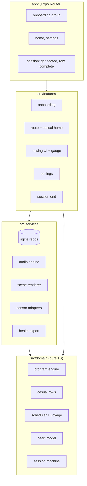
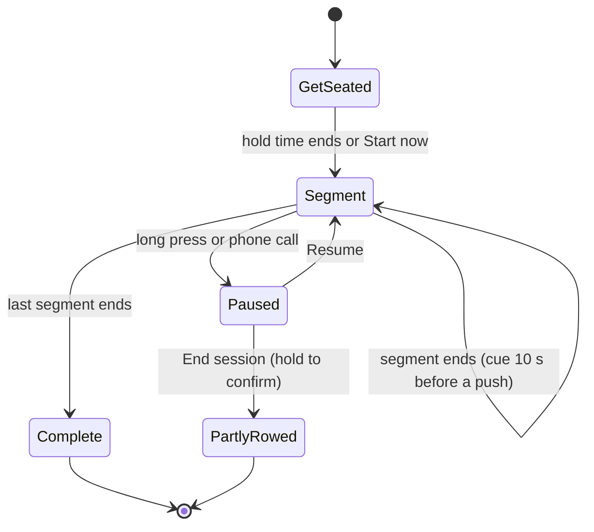
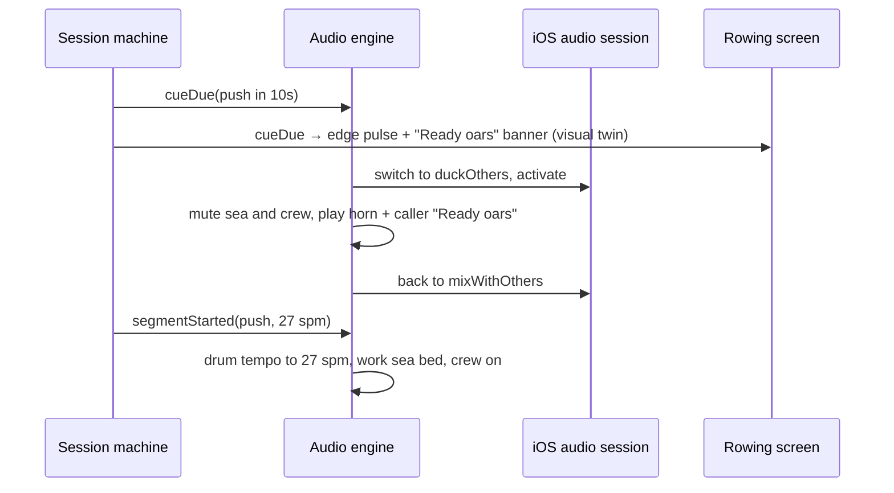

# feat: Rebuild Nor4x4 as an Expo rowing coach

**Target repo:** `nor4x4-app` — the new Expo project, which also holds this plan, its origin requirements, `STRATEGY.md`, and the design boards. Every file path is relative to `nor4x4-app`. The legacy SwiftUI app at `../Nor4x4/` is behavioural reference only.

## Summary

Build a new iOS-first Expo app that delivers the brainstormed Nor4x4: a role-play rowing app where every row is a scene in an ink-painted viking voyage. Rowers pick one of two paths on the first screen: a polarized 4x4 program, or "Just row" at an effort and length they choose. Either way the ship sails Bergen → Iceland. It works hands-free at 1 m, with or without a heart-rate strap or monitor.

The build is ordered to test the riskiest bet first: a **rowable slice** (one hardcoded session with scene, drum, horn and caller) is rowed on a real erg before onboarding, the database or the scheduler exist. Three milestones mark what is usable along the way (see Milestones).

**Changes on 2026-10-31.** This revision folds in the doc review (35 findings, 4 at P1), the product and UX reviews, `STRATEGY.md`, the updated requirements (R48–R59, F4–F5, AE8–AE14) and the regenerated boards:

- **Scope decisions (2026-10-31, later the same day):**
  - PM5 support moves after v1, so stroke rate is the drum's target and nothing measures strokes.
  - Missed sessions wait and the plan pushes back, with a Runna-style choice after 7+ days away (R60).
  - Easy-row format rotation and music detection stay.

- **Rowable slice and milestones.** A new unit, U7, adds the rowable slice. The units are reordered under milestones M1–M3.
- **Earlier reviews.** The coach review moves from a release gate to before the program engine (U1).
- **The four P1s, resolved:**
  - The health check has one rule, block with an unlock path (U15).
  - Live heart rate comes from Bluetooth straps only.
  - Music ducking is proven in the native spike (U4).
  - Onboarding no longer depends on sensors, because pairing moved to the first Set out (U21).
- **Requirement changes now covered:**
  - The Get seated phase replaces the 3-second countdown.
  - Pausing works without a precise tap.
  - Sessions ended early are saved as Partly rowed.
  - The casual path.

---

## Problem Frame

Rowing on a home machine is monotonous, especially on rowers with no monitor, so people stop; guided workouts sit behind subscriptions or connected hardware (see `STRATEGY.md`). The SwiftUI app is a stock-looking interval timer over nine hardcoded plans with an over-aggressive progression, no recovery or easy work, no max-HR model, and unused history (see origin). The rebuild replaces it rather than migrating it.

---

## Requirements

All 60 origin requirements carry forward. Grouped for traceability:

- **R1–R7. Onboarding.**
  - The voyage-first choice between two paths, and the method explainer.
  - Level and max heart rate. On the casual path, max heart rate is optional ("Row by feel").
  - The health check before the first hard session or first Hard casual row.
  - The strap prompt at the first Set out, and the weekly plan with a clash warning.
- **R8–R17. Training program.**
  - Polarized weeks with no consecutive hard days, and the Beginner table.
  - Intermediate and Expert voyages, and "Short on time".
  - Rotating easy-row formats and the weekly long row.
  - The remembered easy-row length and the format swap.
  - Coach review (R17).
- **R18–R22, R48, R49, R60. Home and voyage.** The route list, today's card, Row freely, missed sessions that wait, the next-voyage choice, the weekly tally, the rest-day state, and the choice after a long break.
- **R23–R25. Session start.** Get seated with the looping stroke demo, the demo switch, and reduced motion.
- **R26–R34, R50–R52. Rowing mode.**
  - The scene, its per-segment states and per-leg scenery.
  - The gauge, readable at 1 m, with zone shown as a word plus a shape.
  - No-strap effort guidance and "Strap lost".
  - The progress strip, a visual twin for every audio cue, and timers that count down.
  - Pausing without a precise tap, both orientations as full layouts, and keep-awake.
- **R35–R37. Heart-rate coaching.** Lag-aware scoring, ease-off above 95%, and max-HR self-correction.
- **R38–R43. Sound.** Four layers, the horn and end cues, the recorded caller, auto-mute when the rower's own music plays, sound modes and the mixer, and background audio.
- **R44–R46, R53, R54. After the session.** Stats and route advance, retest comparison, Apple Health, the 1–5 rating, and Partly rowed.
- **R47. Settings.**
- **R55–R59. Just row (casual path).**
  - No schedule.
  - One stop per completed row.
  - Effort and length picked per row.
  - A scene that follows the effort.
  - Path switching in Settings.

Origin actors A1 and A2, flows F1–F5, and acceptance examples AE1–AE15 are honoured by the units below. A3 (the PM5) is deferred until after v1.

---

## Milestones

| Milestone | What it proves | Units | Exit check |
|---|---|---|---|
| **M1 · Rowable slice** | Rowing in the voyage is fun | U1–U7 | The builder rows the slice 3–5 times on their own erg and writes a go / change verdict in `docs/spikes/rowable-slice.md` |
| **M2 · My own coach** | The program and both paths work day to day, with no sensors | U8–U20 | The builder trains with it for two weeks on the 4x4 path and tries Just row; no blocking bugs |
| **M3 · Full v1** | Sensors, Apple Health, polish | U21–U23 | TestFlight build installed by the builder and a few friends; release checklist complete |

M1 is a hard gate: if the slice is not fun, the scene and sound change before M2 starts.

---

## Key Technical Decisions

- KTD1. **Expo SDK 58 with a development build from day one.** BLE, HealthKit, layered audio, and the custom audio module all need native code, so Expo Go is never the target.
- KTD2. **Expo Router for navigation.** Onboarding and the main app are separate route groups gated on a completed profile. The profile records the rower's path (`fourByFour` or `casual`).
- KTD3. **Pure TypeScript domain core.**
  - Program generation, casual-row plans, scheduling, heart-rate math and the session state machine live in a dependency-free domain layer with exhaustive unit tests.
  - Dependencies point one way: routes → features → services → domain.
- KTD4. **expo-sqlite with Drizzle for all persistence.** Repository tests run under Node against `better-sqlite3` through Drizzle's driver swap, so they need no simulator.
- KTD5. **Session time derives from timestamps, not ticks.**
  - Elapsed time is `now − start − paused`, re-synced on app resume.
  - Cues are scheduled ahead on the audio clock. A cue whose time has passed by more than 2 s when the app resumes is dropped, not played late.
- KTD6. **@shopify/react-native-skia + Reanimated 4 for the painted scene.**
  - SkSL runtime effects give the ink-bleed, paper grain and displacement look.
  - Uniforms (time, beat phase, sea state) run on the UI thread.
  - The drum's beat phase is the single clock for the oars.
- KTD7. **react-native-audio-api for sound.** A single Web-Audio context gives sample-accurate loops, tempo control and one-shots on a shared clock.
- KTD8. **Local Expo module for detecting the user's music.**
  - A small Swift module returns `secondaryAudioShouldBeSilencedHint` and emits its change notification.
  - The app re-checks it on every return to the foreground.
- KTD9. **Cue ducking by session-mode switching.**
  - The session runs `mixWithOthers`. Each horn or caller cue switches to `duckOthers`, plays, and switches back, with ambient layers muted for the cue.
  - The U4 spike proves this on device before any audio design depends on it (P1).
- KTD10. **Sensors behind interfaces with fake devices.** Heart-rate and rower inputs are domain interfaces with BLE and simulated implementations. Live heart rate comes from Bluetooth straps only; no Apple Watch in v1.
- KTD11. **BLE library chosen by spike.** U4 builds react-native-ble-plx, its SDK-57+ fork and react-native-ble-manager against SDK 58, and keeps the first that connects to an H10 heart-rate strap. Heart rate recording in the background uses the `bluetooth-central` background mode.
- KTD12. **No stroke measurement in v1.**
  - PM5 support is deferred, so the gauge, drum and stats use the session's target stroke rate.
  - The `RowerSource` interface stays in `src/services/sensors`, so a PM5 parser can be added later without touching the domain.
  - When it is built: parse Concept2's rowing service (general status `0x0031`, additional status `0x0032`) as pure functions, using `ergometer-js` and `c2bluetooth` as byte-layout references.
- KTD13. **@kingstinct/react-native-healthkit for Apple Health.** Workouts are saved as `rowing` with `HKIndoorWorkout` metadata and attached HR samples.
- KTD14. **Responsive layout over orientation locks.**
  - Rowing screens lay out from window dimensions, and both orientations are first-class (R33).
  - Which one gets polished first follows the builder's own holder (see Open Questions).
- KTD15. **Shuimo tokens ported as a TypeScript theme.** Values come from `../../ShuimoDS/Sumi-Design-System/colors_and_type.css`, plus the adapted push and steady roles, sail red, and destructive red agreed in the origin.
- KTD16. **Program content is data, not code.** Voyage tables and casual effort zones live in versioned data files, so a coach's review changes numbers without touching logic.
- KTD17. **One voyage model for both paths.**
  - Route position is the count of completed rows that move the ship. Partly rowed sessions and Row freely don't count.
  - On the 4x4 path, the voyage is an ordered list of planned sessions placed onto rowing days.
  - On the casual path, each row is planned on demand from (effort, length) and appended when completed.
  - Switching paths keeps the count (R59).
- KTD18. **Dev-only test mode.** A build-time flag (`EXPO_PUBLIC_TEST_MODE`, stripped from release builds) swaps in a fake clock and fake sensors, so Maestro flows can run a full session in seconds.

---

## High-Level Technical Design

### Layering



### Session state machine



Each segment carries a type, duration, target zone, target stroke rate and scene state.
- **Types:** warm-up, pickup, push, rest, easy, steady, cool-down, or open.
- **Scene states:** work, rest, horn, easy, swell or rough.
- **Open segments:** Row freely is a single open segment with no end; it counts up.
- **Events:** the machine emits `segmentStarted`, `cueDue`, `segmentEnded`, `sessionCompleted` and `sessionEndedEarly`. Audio, scene and gauge subscribe to these and never own time.

### Cue timeline around a push



---

## Output Structure

```text
nor4x4-app/
  app/
    _layout.tsx
    (onboarding)/  voyage, method, level, heart, week
    (main)/        index (4x4 route or casual home), settings, health-check
    session/[id]/  get-seated, row, complete
  src/
    design/        tokens.ts, typography.ts, components/
    domain/        program/, casual/, schedule/, heart/, session/
    services/      db/, audio/, scene/, sensors/, health/
    features/      onboarding/, route/, rowing/, settings/, session-end/
    content/       voyages/ (beginner, intermediate, expert), efforts.ts
    dev/           testMode.ts (fake clock and sensors, dev builds only)
  modules/other-audio/   local Expo module (Swift)
  assets/        fonts/, audio/
  docs/design/   README.md, screens/, canvas-source/, tools/, flow-start.html, design-spec.md, sound-spec.md
  docs/spikes/   native-modules.md, rowable-slice.md
  docs/review/   coach-review.md
  e2e/           Maestro flows
```

---

## Implementation Units

### M1 · Rowable slice

### U1. Coach review of the program and effort zones

**Goal:** Get the numbers reviewed while they are still one table and nothing depends on them.

**Requirements:** R10, R13, R14, R17, R57, R5

**Dependencies:** None (start now; U9 and U10 wait on it)

**Files:**
- Create: `docs/review/coach-review.md`

**Approach:**
- Send a rowing coach or exercise physiologist four things:
  - the Beginner table (R10);
  - the easy-row formats (R13, R14);
  - the casual effort zones (Easy 55–65%, Intermediate 65–75%, Hard 75–85%, R57);
  - the PAR-Q wording on board 2.5 (R5).
- Record the changes in the review doc, then update the origin requirements before U9.
- Ask for one more decision: whether casual Easy and the 4x4 Steady zone should share one band. The current boards show 101–120 and 105–120.

**Test expectation:** none -- review record.

**Verification:** The review doc names the reviewer, lists every change, and the origin requirements match it.

### U2. Design spec and remaining states

**Goal:** Turn the boards into a build-ready spec and design the few states still missing.

**Requirements:** R1–R60 (design coverage)

**Dependencies:** None

**Files:**
- Create: `docs/design/design-spec.md`
- Modify: `docs/design/canvas-source/`, `docs/design/tools/boards.json`, `docs/design/screens/`, `docs/design/README.md`

**Approach:**
- The boards already cover every requirement. `docs/design/README.md` maps each of the 32 boards to its requirement IDs, and `docs/design/flow-start.html` charts both paths.
- The spec records:
  - tokens (color roles, type scale, spacing, radii) and the ship icon;
  - the interval-shape component;
  - gauge anatomy, with the minimums 75 pt for time and 50 pt for HR in landscape, and 96 pt and 56 pt in portrait;
  - the progress strip;
  - zone word-plus-shape states;
  - motion (stroke demo timings, the reduced-motion still).
- Design the states the README still lists as missing:
  - the casual variant of the health check;
  - a portrait composition of the painting;
  - easy-row scenery per leg;
  - Bluetooth and Health permission-denied states;
  - the Intermediate and Expert retest result.

**Test expectation:** none -- design artefacts.

**Verification:**
- `python3 -I docs/design/tools/check_boards.py docs/design/canvas-source` passes.
- The README's "Not yet designed" list is empty, except for the final art.

### U3. Sound spec and first real assets

**Goal:** Define every sound, and get the few the slice needs recorded, not stand-ins.

**Requirements:** R38–R42, R51, R23

**Dependencies:** None

**Files:**
- Create: `docs/design/sound-spec.md`
- Create: `assets/audio/` (horn, one drum loop, one sea bed, caller lines "Ready oars", "Pull", "Rest your arms", "5-4-3-2-1")

**Approach:**
- Inventory every sound:
  - layers: sea beds per scene state, including swell and rough water; drum loops; crew voices;
  - one-shots: horn, end-of-push, landfall;
  - caller lines, with exact scripts.
- Pair each cue with its visual twin (R51).
- Record the loudness targets, loop lengths, file format and source.
- The slice must not run on text-to-speech or stock placeholders, since sound is half the bet it tests.

**Test expectation:** none -- documentation and assets.

**Verification:** Every event in the session machine has a named asset, and the slice set exists in `assets/audio/`.

### U4. Project scaffold, test plumbing and native spike

**Goal:** Create the Expo SDK 58 project, the test tooling, and prove every native risk before features depend on it.

**Requirements:** KTD1, KTD4, KTD6–KTD9, KTD11, KTD13, KTD18, R41, R43

**Dependencies:** None

**Files:**
- Create: `app.config.ts`, `eas.json`, `tsconfig.json` (strict), `jest.config.js`, lint config
- Create: `app/_layout.tsx`, `src/dev/testMode.ts`
- Create: `modules/other-audio/` (Swift module)
- Create: `docs/spikes/native-modules.md`
- Test: `src/dev/__tests__/testMode.test.ts`

**Approach:**
- Development build on a physical iPhone, with config plugins for Skia, audio-api (background audio), HealthKit and BLE (`bluetooth-central` background mode).
- Spike checks, all on device:
  1. Play two locked loops and a one-shot over Spotify.
  2. Duck Spotify for a horn cue and restore it to full volume (P1).
  3. Read the other-audio hint, including after returning to the foreground.
  4. Keep audio and a BLE HR stream alive with the screen locked for 10 minutes.
  5. Draw one Skia shader full-screen at 60 fps.
  6. Connect to an H10 with each BLE candidate.
  7. Save one test workout to Health.
- Jest runs domain and repository tests under Node; Maestro is installed; test mode swaps in the fake clock and sensors.

**Test scenarios:**
- Test mode reports off in a release-configured build and on when the flag is set in a dev build.

**Verification:** One dev build passes all seven spike checks; `docs/spikes/native-modules.md` records the results and the BLE choice.

### U5. Theme tokens and Shuimo primitives

**Goal:** Port Shuimo to a typed theme and build the shared components every screen uses.

**Requirements:** KTD15, R19, R31, R50

**Dependencies:** U2, U4

**Files:**
- Create: `src/design/tokens.ts`, `src/design/typography.ts`
- Create: `src/design/components/`, containing:
  - Text, Button, Card, SegmentedControl, ProgressBar, Switch, Slider;
  - ShipIcon, IntervalShape, ZoneChip, EffortPicker, LengthChips.
- Create: `assets/fonts/` (Noto Serif SC, Inter)
- Test: `src/design/components/__tests__/IntervalShape.test.tsx`, `ZoneChip.test.tsx`, `src/design/__tests__/tokens.test.ts`

**Approach:**
- Tokens use semantic roles mapped from Shuimo values: push, steady, inZone, primary, destructive and the ink tones.
- IntervalShape renders segment widths by duration and heights by intensity.
- ZoneChip always pairs a word with a shape.

**Patterns to follow:** `Sumi-Design-System/colors_and_type.css`, `Sumi-Design-System/UI_GUIDE.md` in the ShuimoDS repo; boards in `docs/design/canvas-source/`.

**Test scenarios:**
- IntervalShape given warm-up 600 s, push 180 s, rest 180 s renders bars with widths in a 600:180:180 ratio and push bars at full height.
- IntervalShape with an empty segment list renders nothing and does not throw.
- ZoneChip for each state renders its word and shape ("● In zone", "Ease off ▲", "Build ▼", "↓ Recovering"), never color alone.
- Every text-on-surface token pair meets 4.5:1 contrast (computed in test).

**Verification:** A components gallery screen in the dev build matches the boards side by side.

### U6. Session engine

**Goal:** Run a session as a timestamp-driven state machine that emits events for audio, scene and gauge.

**Requirements:** R23, R27, R32, R35, R52, R54, KTD5

**Dependencies:** None (pure TS)

**Files:**
- Create: `src/domain/session/sessionPlan.ts`, `sessionMachine.ts`, `clock.ts`, `summary.ts`
- Test: `src/domain/session/__tests__/sessionMachine.test.ts`, `summary.test.ts`

**Approach:**
- Input is a session plan plus an injected clock. State is derived from elapsed time, never from tick counts.
- Get seated ends when the hold time runs out, or on "Start now".
- Pause comes from:
  - a long press;
  - an audio interruption.
- End session from pause produces a Partly rowed summary.
- Events are emitted once even if the clock jumps.

**Test scenarios:**
- Covers AE9. Get seated ends at the 20 s hold and emits a countdown event for each of the last 5 s; "Start now" ends it at once.
- A cue fires 10 s before each push and never before the warm-up ends.
- Pausing for 60 s mid-push extends the session end by 60 s and keeps the remaining push time unchanged.
- Covers AE10. A long press pauses mid-push; a short tap does nothing.
- The clock jumping forward 95 s (app backgrounded) emits each skipped segment boundary exactly once, in order, and drops stale cues.
- Covers AE11. Ending from pause halfway through produces a Partly rowed summary with the time rowed and no `sessionCompleted` event.
- An open segment (Row freely) never ends on its own and reports elapsed time, not remaining time.
- Summary with no HR samples reports length and pushes completed and omits zone stats.

**Verification:** A full 40-minute 4×4 session simulated with a fake clock produces the expected event list.

### U7. Rowable slice

**Goal:** Row one real session in the voyage before building the rest of the app.

**Requirements:** R23, R26, R27, R29, R31, R32, R38–R40, R50–R52 (first pass)

**Dependencies:** U3, U4, U5, U6

**Files:**
- Create: `app/session/slice.tsx` (dev-only route)
- Create: `src/services/scene/` (first pass: InkScene, the work, rest, horn and easy states)
- Create: `src/services/audio/` (first pass: AudioEngine with drum, sea bed, horn and caller)
- Create: `src/features/rowing/` (CornerGauge, ProgressStrip, HornBanner, GetSeated, long-press pause)
- Create: `docs/spikes/rowable-slice.md`
- Test: `src/features/rowing/__tests__/gauge.test.tsx`

**Approach:**
- One hardcoded plan: week 3 Beginner, 3×3′ with 3′ rests, 30 min.
- The slice has no onboarding, database or scheduler.
- The gauge runs without sensors and uses the effort guide (no strap).
- Scene and audio are built to their final interfaces, so U18 and U19 extend them rather than replace them.
- The builder rows it 3–5 times in their real holder and records, for each row:
  - enjoyment from 1 to 5;
  - readability at 1 m;
  - what felt off.

**Test scenarios:**
- During a push without HR the gauge shows "7–8 of 10 · single words only" and time remaining at 75 pt or larger.
- The progress strip shows seven segments with the now-marker inside the current one.

**Verification:** `docs/spikes/rowable-slice.md` records each row and a go or change verdict. **M1 gate.**

### M2 · My own coach

### U8. Persistence layer

**Goal:** Store the profile, voyage progress, scheduled sessions, session records and HR samples.

**Requirements:** R7, R15, R18, R21, R22, R37, R44, R47, R53–R60, KTD4, KTD17

**Dependencies:** U4

**Files:**
- Create: `src/services/db/schema.ts`, `src/services/db/migrations/`
- Create: `src/services/db/repositories/` (profile, onboardingDraft, voyage, schedule, sessions)
- Test: `src/services/db/__tests__/repositories.test.ts`

**Approach:**
- Repositories expose domain types only; nothing above services sees SQL.
- The profile holds:
  - path, name, level, age or known max HR, and the max-HR source;
  - rowing days and the remembered easy-row length;
  - the last casual effort and length;
  - sound settings, the stroke-demo flag and the hold time;
  - the health-check answers.
- The onboarding draft is saved after each step.

**Test scenarios:**
- Saving a profile then reading it returns identical values, including the remembered easy-row length and the last casual effort and length.
- Recording a session with 300 HR samples persists and reloads all samples in order.
- A Partly rowed record is stored but does not increase route position.
- Running migrations twice is a no-op.

**Verification:** Repository tests pass under Node against `better-sqlite3`.

### U9. Program engine (4x4 path)

**Goal:** Generate a voyage's weekly sessions from level, rowing days and the remembered easy-row length.

**Requirements:** R8–R16, KTD16

**Dependencies:** U1 (reviewed numbers)

**Files:**
- Create: `src/content/voyages/beginner.ts`, `intermediate.ts`, `expert.ts`
- Create: `src/domain/program/generateWeek.ts`, `src/domain/program/easyRowFormats.ts`
- Test: `src/domain/program/__tests__/generateWeek.test.ts`

**Approach:**
- Beginner data mirrors the reviewed table. Intermediate and Expert get two hard sessions a week, a lighter fourth week and a final retest.
- Hard sessions go on chosen days with no two consecutive; the remaining days become easy rows.
- Easy formats rotate through steady, rate ladder and technique.
- From week 2, one easy row a week is a long row at 1.5× the remembered length, rounded to 5 minutes.

**Execution note:** Implement test-first; this is the core of the program.

**Test scenarios:**
- Beginner week 1 with days Mon, Wed, Sat yields one hard session (4×1′, 80–85%, 25 min) and two easy rows at the remembered length, with no long row.
- Beginner week 3 yields 3×3′ / 3′ at 85–90%, 30 min, and one long row.
- Days Mon, Tue, Wed for Intermediate: the generator never places both hard sessions on consecutive days and reports that the week cannot fit two.
- Covers AE3. Remembered length 30 in week 2 or later gives a 45-minute row labelled long.
- Three consecutive easy rows rotate through three different formats.
- Swapping a format on one session does not change the rotation of later sessions.

**Verification:** Generated weeks for all three levels match hand-checked fixtures, which include week 1 and week 3.

### U10. Casual rows

**Goal:** Plan a casual row from an effort and a length.

**Requirements:** R55–R58, KTD16, KTD17

**Dependencies:** U1, U6

**Files:**
- Create: `src/content/efforts.ts`, `src/domain/casual/planCasualRow.ts`
- Test: `src/domain/casual/__tests__/planCasualRow.test.ts`

**Approach:**
- Each effort maps to a zone (55–65%, 65–75%, 75–85% of max HR), a stroke-rate band and a scene state (easy, swell or rough).
- A row is a 5′ warm-up, a steady block, and a 5′ cool-down.
- Without max HR, targets are perceived effort and talk-test copy.

**Test scenarios:**
- Intermediate, 30 min, max 184: warm-up 5′ (easy scene), steady 20′ at 120–138 bpm (swell scene), cool-down 5′ (easy scene).
- Hard, 20 min, no max HR: the steady block targets perceived effort with "a few words" copy and no bpm.
- Easy, 60 min: the steady block is 50′ and the scene is easy throughout.
- An unknown effort or a length outside 20, 30, 45 or 60 is rejected with an error, not defaulted.

**Verification:** Plans for all 12 effort-and-length pairs match a fixture table.

### U11. Next session and voyage progress

**Goal:** Decide what to row next on the 4x4 path, track the ship for both paths, and move rowers between voyages.

**Requirements:** R9, R12, R15, R20–R22, R48, R54, R56, R59, R60, F4

**Dependencies:** U9, U10

**Files:**
- Create: `src/domain/schedule/nextSession.ts`, `longBreak.ts`, `voyageProgress.ts`
- Test: `src/domain/schedule/__tests__/nextSession.test.ts`, `longBreak.test.ts`, `voyageProgress.test.ts`

**Approach:**
- The voyage is an ordered list. On each rowing day, today's session is the first unfinished one, so a missed session waits and the rest of the plan pushes back (R21). Nothing is moved between dates, skipped or stacked.
- **Spacing rule (R9):** if the last row was a hard session yesterday and the waiting session is hard, today shows the next easy row and the hard one follows it.
- **Long break (R60):** after 7 or more days without a row, home asks once.
  - "Pick up where I left off" is the default.
  - "Ease back in" inserts the previous week's sessions before the waiting one.
  - There is no skip-ahead option, and the casual path never asks.
- Route position counts completed rows only. Partly rowed and Row freely don't count.
- The weekly tally counts every completed or Row freely session.
- Finishing the retest completes the voyage and offers the next level, or a repeat; after Expert, only a repeat.

**Test scenarios:**
- Covers AE5. A missed Wednesday easy row is Saturday's session, Saturday's own session moves to the next rowing day, nothing doubles up, and the ship has not moved.
- Covers AE6. A hard session Monday and a waiting hard session on Tuesday: Tuesday shows the next easy row, and the hard session follows it.
- Covers AE15. After 8 days away, both choices leave the ship where it was. "Ease back in" puts last week's three sessions first, and each moves the ship only when rowed.
- 6 days away does not ask; 7 days does, once; answering it does not ask again on the next open.
- Short on time on a 4×4 day replaces it with a 1×4 session of about 17 minutes and keeps the week's progression.
- Covers AE2. Changing an easy row from 30 to 20 minutes makes 20 the remembered length.
- Covers AE11. A Partly rowed session stays next on the route and the ship does not move.
- Covers AE12. A 20-minute Easy casual row and a 60-minute Hard casual row each move the ship one stop.
- Covers AE14. Switching from casual to 4x4 with the ship three stops along keeps it three stops along.
- Completing the Expert retest offers only a repeat.

**Verification:** Fixtures cover a full eight-week voyage with two missed sessions and one long break, and a casual voyage of ten rows with one Partly rowed.

### U12. Heart-rate model

**Goal:** Turn raw HR into zones, scores, warnings and max-HR updates.

**Requirements:** R4, R30, R35–R37, R50, R57

**Dependencies:** None (pure TS)

**Files:**
- Create: `src/domain/heart/zones.ts`, `scoring.ts`, `maxHr.ts`, `effortGuide.ts`, `zoneState.ts`
- Test: `src/domain/heart/__tests__/zones.test.ts`, `scoring.test.ts`, `maxHr.test.ts`, `zoneState.test.ts`

**Approach:**
- Estimated max HR uses 208 − 0.7 × age; a known max overrides it.
- Push scoring counts the final 3 minutes of each push, or its final half when the push is shorter than 4 minutes.
- Above 95% of max for 5 s raises an ease-off event once per push.
- A session peak above the stored max proposes a new max and recalculated zones.
- Zone state is in, above or below, plus recovering during rests.

**Test scenarios:**
- Age 34 gives estimated max 184, push zone 156–175, and steady zone 105–120.
- Age 34 gives casual zones Easy 101–120, Intermediate 120–138, and Hard 138–156.
- Covers AE1. A 4-minute push reaching the zone at 1:40 scores only the final 3 minutes and records no miss for the ramp.
- A 1-minute push scores its final 30 s.
- A single noisy sample at 97% does not raise ease-off; five seconds above 95% does, once.
- A session peak of 190 with stored max 184 proposes 190; a peak of 180 proposes nothing.
- Covers AE7. No HR source during a push returns "7–8 of 10 · single words only".
- HR 180 against a 156–166 target returns "Ease off ▲", and 150 returns "Build ▼".

**Verification:** All heart tests pass; scoring output matches a hand-computed fixture session.

### U13. Onboarding (both paths)

**Goal:** Build voyage-first onboarding with the two paths.

**Requirements:** R1–R4, R7, R9, R55, F1, F5

**Dependencies:** U5, U8, U9, U12

**Files:**
- Create: `app/(onboarding)/voyage.tsx`, `method.tsx`, `level.tsx`, `heart.tsx`, `week.tsx`
- Create: `src/features/onboarding/`
- Test: `src/features/onboarding/__tests__/onboarding.test.tsx`, `e2e/onboarding-4x4.yaml`, `e2e/onboarding-casual.yaml`

**Approach:**
- "Train with the 4x4" runs method, level, heart and week.
- "Just row" runs heart only; it can be skipped with "Row by feel".
- Each path shows its own progress bar.
- The draft is saved after each step. The profile is committed on "Set out for Iceland" (4x4) or Continue / Row by feel (casual).
- There is no pairing or health step during onboarding. Those come at first use (U15, U21), which breaks the old dependency loop with sensors (P1).

**Test scenarios:**
- Completing the 4x4 path with age 34 and days Mon, Wed, Sat creates a profile with max 184 and a generated first week.
- Covers F5. Picking Just row, then Row by feel, creates a casual profile with no max HR and lands on the casual home.
- Choosing days that force hard sessions back to back shows the clash warning and keeps Continue disabled.
- Continue on level stays disabled until name and level are set.
- Relaunching mid-onboarding resumes at the last unfinished step on the same path.

**Verification:** Both Maestro flows pass on the simulator. The screens match boards 1.0–1.4 and 1.3c.

### U14. Home: route, casual home, rest day

**Goal:** Show the voyage, with today's card on the 4x4 path and the effort picker on the casual path.

**Requirements:** R12, R15, R16, R18–R21, R48, R49, R55–R57, F3, F4

**Dependencies:** U5, U8, U9, U10, U11

**Files:**
- Create: `app/(main)/index.tsx`
- Create: `src/features/route/`, containing:
  - RouteList, TodayCard, SessionCard, LandmarkRow, LengthPicker, FormatSwap, WeekTally;
  - CasualHome, RestDay, WelcomeBackSheet.
- Test: `src/features/route/__tests__/route.test.tsx`, `casualHome.test.tsx`

**Approach:**
- **4x4 path:**
  - Upcoming sessions sit above today and completed ones below, with landmarks between legs.
  - Easy cards let the rower edit the length and swap the format; hard cards offer Short on time.
  - When nothing is scheduled today, the rest-day state offers Row freely.
  - A waiting session is labelled "Waiting from Wed"; after a long break, the welcome-back sheet (U11) opens over home.
- **Casual path:**
  - Rows this week, with no target.
  - The effort picker and length chips default to the last choice.
  - The route shows completed rows. There is no Row freely.

**Test scenarios:**
- Today's week-3 card shows "Three 3′ pushes", 30 min, and 156–166 bpm.
- Covers AE2. Editing an easy row's length to 20 updates that card and the next easy card.
- Swapping format changes only that card.
- Covers AE5 and F4. A missed session shows as the next session with "Waiting from Wed", and later sessions show as pushed back.
- Covers AE15. Opening the app 8 days after the last row shows the welcome-back sheet with "Pick up where I left off" selected.
- With nothing scheduled today, the rest-day state shows Row freely and the tally.
- On the casual home with max HR known, the picker shows bpm ranges; with Row by feel, it shows perceived effort instead.
- Picking Hard and 45 min, then setting out, plans a Hard 45-minute row, and the next visit defaults to Hard and 45.

**Verification:** Home matches boards 2.1, 2.4, 2.4b and 2.11 with seeded data for weeks 1, 3 and 8 and a casual profile.

### U15. Health check and lock

**Goal:** Ask the health questions just before they matter, with one rule for the lock and one way to lift it.

**Requirements:** R5, AE8, AE13

**Dependencies:** U8, U14

**Files:**
- Create: `app/(main)/health-check.tsx`, `src/features/onboarding/healthCheck/`
- Test: `src/features/onboarding/__tests__/healthCheck.test.tsx`

**Approach:**
- It appears on the first Set out of a 4x4 hard session or a Hard casual row.
- Any "yes" **blocks** hard sessions and Hard casual rows (one rule, P1):
  - Their cards show the disclaimer and can't start.
  - On the casual picker, Hard is hidden.
  - Easy rows, Easy casual rows and Intermediate casual rows stay open.
- Answers are editable in Settings (U16). Changing every answer to "no" lifts the lock.

**Test scenarios:**
- Covers AE8. A "yes" makes hard-session cards show the disclaimer and refuse to start, while easy rows start normally.
- Covers AE13. A casual "yes" before a first Hard row hides Hard, and Easy and Intermediate start normally.
- Changing the answer to "no" in Settings unlocks hard sessions without asking again.
- An answered check is not shown again on later Set outs.

**Verification:** The screens match boards 2.5 and 2.6, and the casual variant from U2.

### U16. Settings

**Goal:** Let the rower edit the path, profile, zones, days, health answers, sound and session options.

**Requirements:** R24, R37, R41, R42, R47, R59

**Dependencies:** U5, U8, U11

**Files:**
- Create: `app/(main)/settings.tsx`, `src/features/settings/`
- Test: `src/features/settings/__tests__/settings.test.tsx`

**Approach:**
- Edits open sheets. Changing max HR or days regenerates future sessions only.
- The mixer writes per-layer volumes, which U19 consumes.
- "When my music plays" sets the auto-switch behaviour.
- Switching paths keeps the ship's position.
- Restart voyage is destructive and needs confirmation.

**Test scenarios:**
- Changing max HR from 184 to 190 updates future cards' bpm and leaves completed records unchanged.
- Changing rowing days regenerates only sessions after today.
- Turning off the stroke demo keeps Get seated but shows no demo.
- Switching from Just row to the 4x4 path asks for level and days, then keeps the ship in place.

**Verification:** Settings matches board 2.2.

### U17. Rowing mode, complete

**Goal:** Finish the session screen around the engine for every session type and both orientations.

**Requirements:** R23–R25, R29–R34, R50–R52, F2, F3, F5

**Dependencies:** U6, U7, U12

**Files:**
- Create: `app/session/[id]/get-seated.tsx`, `app/session/[id]/row.tsx`
- Modify: `src/features/rowing/` (adds PauseSheet with hold-to-confirm End, StrokeDemo, StrapStatus and PortraitLayout)
- Test: `src/features/rowing/__tests__/gauge.test.tsx`, `pauseSheet.test.tsx`, `e2e/session.yaml`

**Approach:**
- Overlays sit over the scene from U18.
- The layout reflows from window size:
  - landscape uses the corner panel at 224 pt;
  - portrait uses a bottom band with time at 96 pt and HR at 56 pt.
- Keep-awake lasts for the session only.
- Row freely shows time rowed and a "doesn't move the ship" strip.
- Under reduced motion, the stroke demo shows a still catch.

**Test scenarios:**
- During a push with HR 162 and target 156–166, the gauge shows "● In zone".
- Covers AE7. Without HR, the gauge shows the effort guide in place of bpm.
- When the strap drops mid-push, the gauge shows "Strap lost · reconnecting" and falls back to the effort guide.
- A long press pauses. The pause sheet shows Resume, Restart this push (only during a push), sound mode, and End session. End needs a hold.
- With reduced motion on, the stroke demo renders the still catch and Get seated still counts down.
- Rotating to portrait keeps the gauge, strip and pause gesture available, with no gauge number below its minimum size.

**Verification:**
- The Maestro session flow completes a 4×4, a casual Hard row and a Row freely session in test mode.
- The screens match boards 3.1–3.10 and 3.1p–3.5p, with stroke rate shown as the drum's target.

### U18. Ink-wash scene renderer

**Goal:** Grow the slice's scene into the full animated painting.

**Requirements:** R25–R28, R58, KTD6

**Dependencies:** U2, U7

**Files:**
- Modify: `src/services/scene/` (adds layers/, shaders/, sceneStates.ts, legs.ts, seaState.ts, portrait composition)
- Test: `src/services/scene/__tests__/sceneStates.test.ts`, `seaState.test.ts`

**Approach:**
- **Layers:** paper ground, sky, mountain washes, water, hull and benches, rowers, oars, sail, prow, and effects (spray, horn waves).
- **Shaders:** SkSL supplies edge bleed and paper grain. Static layers are cached; only the oars, water and effects animate.
- **Oars** follow the drum's beat phase.
- **Sea states:**
  - calm (easy rows and Easy casual rows);
  - swell (Intermediate), with rolling water and a gently rising horizon;
  - rough (Hard), with broken crests, spray and a pitching horizon.
- **Legs:** each voyage leg defines a palette and a set of landmarks.
- **Portrait** uses its own composition from U2, not a crop of landscape.
- **Reduced motion** freezes the time uniform and the horizon.

**Test scenarios:**
- A push maps to the work state; a rest maps to rest; the 10 s before a push maps to the horn state.
- Covers R58. A casual Intermediate block maps to swell, Hard to rough, and Easy to calm. Warm-up and cool-down map to calm for every effort.
- Leg index 3 returns a different palette and landmark set from leg 2.
- At 27 spm, one oar cycle completes every 2.22 s.

**Verification:**
- 60 fps for 10 minutes in the rough sea state on the oldest supported iPhone, with no thermal warning.
- A visual review against boards 3.2, 3.4, 3.9 and 3.10.

### U19. Audio engine and music detection

**Goal:** Grow the slice's audio into the full layered engine that plays well with the user's music.

**Requirements:** R38–R43, R51, KTD7–KTD9

**Dependencies:** U3, U4, U7

**Files:**
- Modify: `src/services/audio/` (adds layers.ts, cues.ts, soundModes.ts, interruptions.ts)
- Create: `modules/other-audio/ios/OtherAudioModule.swift`, `modules/other-audio/index.ts`
- Test: `src/services/audio/__tests__/soundModes.test.ts`, `cues.test.ts`

**Approach:**
- One audio context; each layer is a gain-controlled loop.
- The drum tempo follows the target stroke rate, and the sea bed follows the sea state.
- Cues are scheduled ahead on the audio clock, and stale cues are dropped.
- When other audio is playing, the mode becomes Cues only and a notice appears. Stopping the music restores the previous mode.
- Auto-switching never overrides a mode the rower chose.
- A phone call pauses the session (U6).

**Test scenarios:**
- Covers AE4. With music playing at the start, the sea, crew and drum gains are zero and the notice shows; the horn and caller still play.
- Music stopping mid-session returns to the previous mode, unless the rower picked one.
- Silent mode plays no layer or cue, and the session still advances.
- A `cueDue` event schedules the horn at the audio-clock time of the push start minus 10 s.
- A cue more than 2 s stale after resume is dropped.
- Setting the crew mixer volume to 0 mutes the crew in Full ship mode only.

**Verification:** On device with Spotify playing, the horn ducks the music, the music returns to full volume after the cue, and audio keeps playing with the screen locked.

### U20. Session end: complete, Partly rowed, retest

**Goal:** Close each session with stats and a rating, move the ship, and compare retests.

**Requirements:** R22, R37, R44, R45, R53, R54, R56

**Dependencies:** U8, U11, U12, U6

**Files:**
- Create: `app/session/[id]/complete.tsx`, `src/features/session-end/`
- Test: `src/features/session-end/__tests__/complete.test.tsx`, `retest.test.ts`

**Approach:**
- The screen shows the route advance, time in the push zone, peak HR, length and pushes completed, with one coaching line. Casual rows show time in the chosen effort zone.
- It offers the 1–5 rating, which can be skipped.
- Partly rowed shows its summary and leaves the ship where it is.
- Retests compare HR at the same drum rate, which assumes the rower follows the drum. With no strap, they compare completion and enjoyment. Pace-based retests come with PM5 support after v1.
  - Beginner retests are compared with week 6.
  - Intermediate and Expert retests are compared with the last hard session before the retest.
- A max-HR proposal appears here.
- The separate history screen is dropped; the route already shows past sessions.

**Test scenarios:**
- A completed 4×4 with HR shows zone time from U12 scoring, not raw time.
- A session without HR hides the zone stats and shows length and pushes completed.
- Covers AE11. A Partly rowed session shows "the ship stays put" and the route does not advance.
- An Intermediate retest compares against the last hard session before it, not against week 6.
- A no-sensor retest compares completion and enjoyment.
- A proposed max-HR update can be accepted or dismissed, and only acceptance changes the zones.

**Verification:** The screens match boards 2.3, 2.9 and 2.10. **M2 gate:** the builder trains with the app for two weeks.

### M3 · Full v1

### U21. Heart-rate strap

**Goal:** Pair and stream live heart rate, asked at the first Set out.

**Requirements:** R6, R29, R30, A2, KTD10, KTD11

**Dependencies:** U4, U17

**Files:**
- Create: `src/services/sensors/` (HeartRateSource, RowerSource, ble/, fake/)
- Create: `src/services/sensors/parsers/heartRateMeasurement.ts`
- Create: `src/features/rowing/StrapPrompt.tsx`
- Test: `src/services/sensors/parsers/__tests__/heartRateMeasurement.test.ts`, `src/features/rowing/__tests__/strapPrompt.test.tsx`

**Approach:**
- The strap prompt shows once, at the first Set out on either path. Pairing is also in Settings, and the prompt can always be skipped with "Row by the plan".
- The parser handles HR Measurement `0x2A37` (8- and 16-bit formats, optional RR intervals).
- The app reconnects quietly when the strap drops.
- `RowerSource` keeps only its fake implementation until PM5 support is built (KTD12).

**Test scenarios:**
- An HR packet with flags 0x00 and value 0x9C parses to 156 bpm.
- An HR packet with the 16-bit flag parses a two-byte value correctly.
- A device disconnect mid-push switches the gauge to the effort guide within 5 s, and back on reconnect.
- With Bluetooth off or denied, the prompt shows the unavailable state and "Row by the plan" starts the session.
- The prompt is not shown again after it has been answered once.

**Verification:** A real H10 streams to the gauge during a 10-minute session with the screen locked. The prompt matches boards 2.7 and 2.8.

### U22. Apple Health export

**Goal:** Save each completed or Partly rowed session to Apple Health.

**Requirements:** R46, KTD13

**Dependencies:** U4, U20 (not U21: export works with or without sensors)

**Files:**
- Create: `src/services/health/healthExport.ts`
- Test: `src/services/health/__tests__/healthExport.test.ts`

**Approach:**
- On session end, save a rowing workout with indoor metadata and its actual duration, plus HR samples when there are any.
- When permission is denied, skip the export and show a one-line note.

**Test scenarios:**
- A completed session maps to one rowing workout with its start, end and all HR samples.
- A Partly rowed session exports with its actual end time.
- A session without HR exports a workout with no samples.
- Permission denied produces no export and shows the note.

**Verification:** The workout appears in the Health app, with heart-rate data when a strap was worn.

### U23. QA, accessibility, performance, TestFlight

**Goal:** Prove the full flows on device and ship to TestFlight.

**Requirements:** R25, R33, R34, R43, R51

**Dependencies:** U8–U22

**Files:**
- Create: `e2e/full-voyage.yaml`, `e2e/casual-voyage.yaml`, `docs/release/checklist.md`

**Approach:**
- End-to-end Maestro flows run in test mode.
- Manual device runs cover audio, BLE and Health.
- A VoiceOver pass covers onboarding, home and pause.
- A deaf-user pass confirms each cue's visual twin.
- A performance pass covers the rough sea state.

**Test scenarios:**
- Fresh install, 4x4 path: onboarding, then the first session, then complete; home shows the next session.
- Fresh install, Just row: onboarding, a Hard row (health check, strap prompt), then complete; the ship moves one stop.
- A simulated eight-week voyage with two missed sessions ends with the Intermediate voyage offered.

**Verification:** The release checklist is complete and the TestFlight build is installed. **M3 gate.**

---

## Scope Boundaries

- Carried from the origin and deferred for later:
  - assessment rows;
  - rotating 4×8 and 30/15 hard sessions;
  - an Apple Watch app, including watch heart rate;
  - effort-reactive scenes, and rival or chase mechanics;
  - Android.
- Carried from the origin, outside this product's identity: paid features, live instructors or filmed video, social features and accounts, and on-water rowing.
- Dropped from this plan after review:
  - the separate history screen (the route shows past sessions);
  - the speculative Expert 5×4 variant.

### Deferred to Follow-Up Work

- **Remaining recorded assets:** the crew voices, every sea bed, and the full caller script beyond the slice set (tracked in `docs/design/sound-spec.md`).
- **Final illustration and animation art:** the boards and slice use placeholder paintings.
- **Cloud sync and accounts:** all data stays on the device.
- **History migration from the SwiftUI app:** it never wrote any history.
- **PM5 support (after v1, decided 2026-10-31):**
  - first-stroke start and auto-pause after 8 s without strokes;
  - measured stroke rate and pace, and pace-based retests;
  - the parser in KTD12.

  Board 3.1e is kept in `docs/design/deferred/`.
- **Kept after review (decided 2026-10-31):** easy-row format rotation and music detection. Automatic missed-session moves were replaced by the simpler "missed sessions wait" rule (U11).

---

## Risks & Dependencies

| Risk | Mitigation |
|---|---|
| The rowable slice isn't fun | M1 gate before any M2 work; scene and sound change first |
| Coach changes the program after it is built | U1 runs before U9 and U10; content is data (KTD16) |
| Music ducking glitches or fails to restore | Proven in the U4 spike before the audio design depends on it |
| BLE library unstable on SDK 58 / RN 0.88 | U4 spikes three candidates; sensors sit behind interfaces |
| Background HR recording stops with the screen locked | `bluetooth-central` background mode and an audio session kept alive in Silent mode, checked in U4 |
| react-native-audio-api is pre-1.0 and may change APIs | Wrap it in `src/services/audio`; pin the version; U4 proves the core features |
| Full-screen shaders drain battery or drop frames in 45–60 minute rows | Cache static layers, limit live shaders, profile the rough sea state on the oldest supported iPhone |
| iOS 27 ignores orientation locks | Responsive layouts per KTD14 |
| HealthKit library uses initializers Apple deprecated in iOS 17 | Isolate in one service; watch for removal |
| PAR-Q wording is not reviewed | U1 includes it; App Store release, if ever, needs legal review on top |
| Scope is large for one builder | M2 is usable without sensors; PM5 is deferred and the scheduler is simplified to "missed sessions wait" |
| Retests without a PM5 assume the rower follows the drum | Coaching lines and the caller keep the rower on the drum; pace-based retests return with PM5 support |

---

## Open Questions

### Resolve Before or During M1

- Which orientation the builder's rower holder uses, which decides the layout the slice polishes first (U7).
- Whether casual Easy and the 4x4 Steady zone share one band (U1).

### Deferred to Implementation

- Drum tempo method: stretching the playback rate or a pre-rendered set of tempos (U3 and U19, settled by a listening test).
- Exact technique-row drills and rate-ladder step timing (U9, with coach input).
- Intermediate and Expert week-by-week tables (U9, pending U1).
- How the 4x4 program picks up when a rower switches to it with the ship already partway along (U11, R59).
- Number of scenery legs per voyage needed to avoid visible repeats (U18).
- Oldest supported iPhone, set by U18 profiling.

---

## Sources & Research

- Origin requirements: `docs/brainstorms/2026-10-29-nor4x4-rebuild-requirements.md`. Strategy: `STRATEGY.md`.
- Design: `docs/design/README.md` maps each of the 32 boards to its requirement IDs. Screenshots are in `docs/design/screens/` and the flow chart is `docs/design/flow-start.html`. Live canvas: https://claude.ai/artifact/F5M3koEizjUmoML6iApBQ5
- Current behaviour reference: `../Nor4x4/Nor4x4/Catalog.swift`, `../Nor4x4/Nor4x4/WorkoutManager.swift`, `../Nor4x4/Nor4x4/TimerView.swift`, `../Nor4x4/Nor4x4/LevelSelectionView.swift`.
- ShuimoDS at `../../ShuimoDS/`: `Sumi-Design-System/colors_and_type.css`, `Sumi-Design-System/README.md`, `Sumi-Design-System/assets/mountains.svg` (procedural wash technique).
- Expo SDK 58 changelog (RN 0.88, iOS 27 orientation change): https://expo.dev/changelog/sdk-58
- react-native-ble-plx: https://github.com/dotintent/react-native-ble-plx ; Concept2 PM5 Bluetooth spec: https://concept2.com/support/software-development ; byte-layout references: `ergometer-js`, https://github.com/OpenRowingCommunity/c2bluetooth
- @kingstinct/react-native-healthkit: https://github.com/kingstinct/react-native-healthkit
- react-native-audio-api AudioManager: https://docs.swmansion.com/react-native-audio-api/docs/next/system/audio-manager
- React Native Skia in Expo SDK 58: https://docs.expo.dev/versions/v58.0.0/sdk/skia.md
- Training evidence: Helgerud 2007, Tjønna 2013, Seiler and Sylta 2013, Rønnestad (30/15), Seiler polarized distribution.
